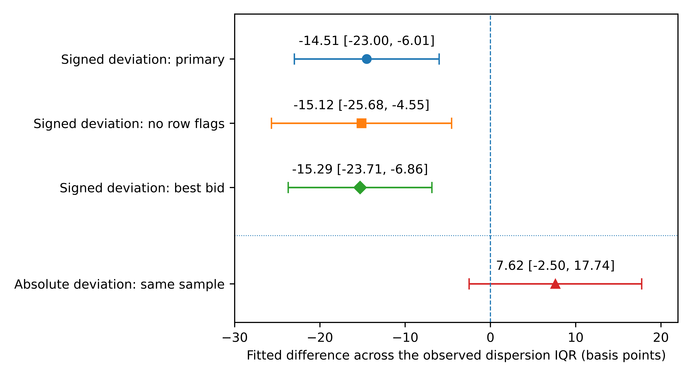
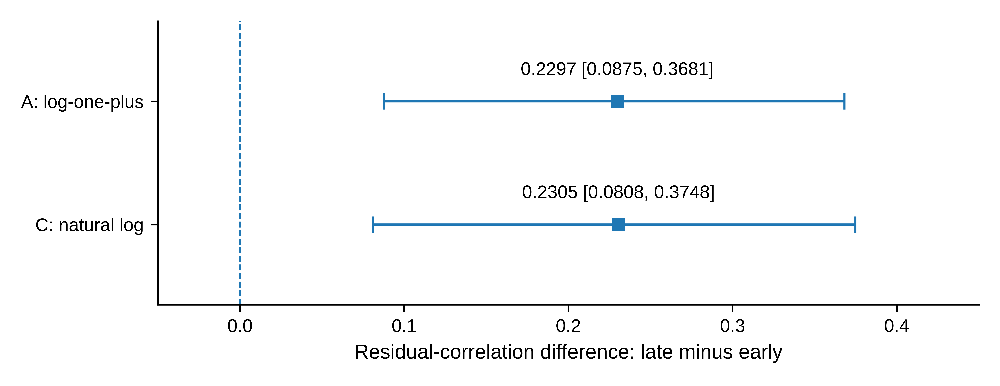

# Quantity dispersion and reported price deviations in European carbon auctions

*Conditional associations and historical scope*

Zhongfei Tian · Xiang Wang  
Zhengzhou University of Aeronautics, Zhengzhou, Henan, China  
Corresponding author: Zhongfei Tian · 15517837680@163.com

# Abstract

Carbon-auction reports record the scale and dispersion of bidding, but these dimensions need not carry the same information. We examine reported bid and award dispersion in 1,281 successful European Union Allowance auctions during 2020–2025 and relate bid dispersion to official price comparisons for 240 German auctions. Conditional residual correlations between the quantity ratios are about 0.65 under two transformations. In the German subsample, an observed interquartile range of transformed bid dispersion corresponds to a fitted difference of −14.51 basis points in the official-reported signed deviation, with an exploratory quarter-clustered 95% interval of \[−23.00, −6.01\]. The comparison conditions on scale, participation, demand coverage, submitted-price range, the same-auction clearing price and year effects. Its direction persists in two predefined source subsets, but the absolute-deviation interval includes zero and omitting 2022 materially attenuates the coefficient. The quantity relationship is stronger in 2023–2025 despite lower marginal ratio medians. Selected-moment weighting retains positive period contrasts without equalizing the auction-volume distributions, while a separate 2026 quantity sample supplies limited new-time evidence. The results distinguish quantity co-variation, signed price position and absolute price distance. They document incremental conditional associations within the reporting archive, rather than causal allocation effects, improved pricing efficiency or forecasting gains. Interpretation retains the official signed convention and the exploratory status of inference.

Keywords: European Union Allowances; primary auctions; quantity dispersion; reported price deviations; measurement; temporal heterogeneity

JEL classification: D44; C13; Q58

# 1 Introduction

Public carbon-auction reports contain more than a clearing price. They also record the quantities submitted and awarded, the number of participants and the dispersion of those quantities. The European Commission reports quantity moments alongside aggregate auction outcomes, while the European Securities and Markets Authority (ESMA) distinguishes participation from concentration in its market monitoring (European Commission 2024; ESMA 2025). These reporting dimensions motivate an empirical question: after accounting for the scale of an auction and the intensity of participation, does the dispersion of submitted quantities contain additional information about its recorded outcomes?

The question matters because aggregate demand and the distribution of demand are different objects. A given total submitted quantity can be distributed relatively evenly or unevenly over the units underlying a reported statistic. Counts and totals constrain a mean, but generally do not determine a standard deviation. Similarly, the range of submitted prices measures variation along a price dimension rather than the dispersion of bid quantities. Establishing a conditional relationship beyond these conventional measures is therefore a more informative exercise than reporting an unconditional correlation between auction statistics. It does not, on its own, identify the behaviour or market power of particular bidders.

We address two related questions in European Union Allowance (EUA) auctions. First, how strongly do the reported bid-side and award-side dispersion ratios co-vary after controlling for scale, participation and time? Second, in the subset for which an official secondary-market comparison is available, is bid dispersion associated with the reported signed price deviation beyond the same conventional auction characteristics? The first question describes the joint behaviour of two quantity indicators. The second connects one of those indicators to a different outcome. Neither question presumes that a reported standard deviation and its paired mean refer to an identical underlying population throughout the archive.

Awards originate in submitted bids, so some quantity association is plausible. What requires evidence is its conditional magnitude and historical scope, and whether the bid statistic also has a price-related association. We do not treat these as a causal sequence from bids through awards to prices. The price model does not identify an award-mediated channel. Instead, the analyses use different outcome variables and conditioning sets to establish two separate empirical relationships. This distinction allows the pricing question to be investigated without claiming to have recovered individual valuations, a demand schedule or an efficient benchmark price.

The quantity analysis uses 1,281 successful auctions in the EU, DE and PL reporting series of the European Energy Exchange (EEX), covering 2020–2025. Its price extension uses 240 German auctions in 21 quarters, selected by fixed source-quality rules from the 275 German auctions in the historical archive. The extension adds the bid-dispersion ratio to a baseline containing auction volume, participant counts, demand coverage, submitted-price range, the same-auction clearing price, year effects and reference type. The baseline and extended model use identical observations. The German comparisons are a matched subset, not an additional 240 observations or a second independent market.

The pooled quantity residual correlation is approximately 0.65 under both transformations. The price extension yields a negative conditional association: a difference equal to the observed interquartile range of transformed bid dispersion corresponds to a fitted signed-deviation difference of −14.51 basis points. Its quarter-clustered 95% interval is \[−23.00, −6.01\]. The direction also appears in two predefined source subsets. However, the absolute-deviation interval includes zero, and deleting 2022 substantially reduces the signed coefficient. Thus, the extension provides information about the position of the reported price comparison, not evidence that prices move closer to the reference or that the relationship has constant strength over time.

The historical quantity comparison provides a further distinction. The later period, 2023–2025, has lower marginal medians of both dispersion ratios but stronger conditional co-variation. An overlap-weighted comparison retains positive period contrasts after balancing selected composition moments, without equalizing the full auction-volume distribution. A separate January–September 2026 quantity sample also has a positive association, but its nine-month span limits temporal inference. These exercises qualify the historical relationship rather than multiply the number of independent confirmations.

The contribution is a measurement-explicit account of the joint information in published auction statistics. Relative to official marginal reporting, we quantify conditional quantity co-variation and distinguish it from changes in indicator levels. Relative to price-focused auction work such as Bosco (2023), we examine the additional association of quantity dispersion with an official-reported price comparison after including conventional demand, participation and submitted-price controls. We also distinguish signed position from absolute distance, an important distinction when interpreting an auction-to-reference comparison. The contribution is empirical and conditional; it is not a new estimator, a claim of prior misuse of official statistics or a demonstrated trading benefit.

The study is retrospective and exploratory. Historical results were inspected before supplementary checks, and the price specifications were finalized after source-data inspection but before their first fit. The order of presentation below brings the two core findings together without changing that research sequence. Section 2 develops the economic and measurement context. Section 3 describes the data and sample hierarchy, and Section 4 sets out the two core estimands. Section 5 presents quantity and price results side by side. Section 6 examines their historical scope and sensitivity, followed by discussion and conclusions in Sections 7 and 8. Online Resource 1 preserves the detailed diagnostics, source restrictions and study sequence.

# 2 Auction reports and empirical questions

## 2.1 Allocation and the unit of observation

EEX describes its emissions auctions as single-round, sealed-bid, uniform-price auctions. Bids are ranked by price, successful orders pay the clearing price, and marginal execution can be partial. Participants may bid on their own account or on behalf of clients (EEX *n*.*d*.). A reporting participant therefore need not be the final installation using allowances for compliance. This distinction matters for the quantities and counts studied here, which cannot be converted into client-level demand without additional information.

Allowance auction design matters for rents and allocation as well as the clearing price (Cramton and Kerr 2002). Multi-unit auction theory links bidding incentives and demand reduction to allocation outcomes (Ausubel et al. 2014). These considerations motivate attention to quantity distributions. Our data contain public aggregate moments rather than valuations or participant-specific bid schedules, so they support a description of quantity co-variation, not a test of strategic demand reduction.

The observation in this article is a completed auction report. It is not an individual order, a bidder balance sheet or an installation's eventual compliance position. Consequently, variation between reports can reflect changes in the mix of participants, their submitted quantities, the allocation outcome and the reporting convention. A report-level analysis can describe their joint variation, but cannot determine which participant or client generated it. The distinction is especially important for award statistics, because an award-side population may differ from a bid-side population and unsuccessful quantities need not enter both summaries in the same way.

## 2.2 Why totals, dispersion and price comparisons differ

Scale, participation and dispersion convey different aspects of an auction. Auction volume measures supply, the submitted-to-auction volume comparison describes demand coverage, and participant counts describe the breadth of recorded participation. Quantity dispersion adds information about how the underlying reported quantities vary around their mean. Holding totals and counts fixed does not, as an algebraic matter, fix that variation. This motivates including the conventional scale and participation variables in the comparison, rather than interpreting a large dispersion ratio as an automatically distinct economic factor.

Normalization introduces a second issue. Dividing a reported standard deviation by a reported mean makes the ratio dimensionless, but does not authenticate the statistical population or eliminate dependence on quantities and counts in the denominator. Ratios can generate misleading regression interpretations when their components are ignored (Kronmal 1993). Our main definitions preserve the reported fields, while a separate log-scale identity check makes the role of constructed denominators explicit. The identity check is an explanation of the estimand, not a new economic result or proof that all mechanical links have been removed.

A price comparison introduces a third dimension. The signed deviation locates the official reported comparison on either side of its reported zero; the absolute deviation describes its distance from zero. A negative conditional association with the first does not logically imply a negative association with the second. Lowering a signed value may move it toward zero, through zero or farther from zero. We therefore retain a separate absolute-outcome specification instead of treating a signed coefficient as an efficiency statistic. Because the precise subtraction-and-denominator convention has not been independently established for the complete report set, economic labels such as an auction discount are not substituted for the official signed field.

There is also no unambiguous directional prediction from the public quantity moments alone. More dispersed submitted quantities could accompany different demand compositions, bidding choices or market conditions. Those explanations need not imply the same signed price comparison, and the data do not separate them. Our price question is consequently a two-sided test of an additional conditional association, not a directional test of a structural auction model. Reporting the sign, magnitude and uncertainty gives the empirical content of that question without assigning the estimate to an unobserved mechanism.

## 2.3 Relation to auction and measurement research

Bosco (2023), first published online in 2022, studies EUA auction prices and returns using generalized autoregressive conditional heteroskedasticity (GARCH) specifications. Participation, demand coverage and the maximum-minus-minimum submitted price enter that analysis. Our price baseline retains these dimensions, including the submitted-price range, while the focal addition is a quantity-dispersion ratio. The outcome also differs: we analyse the official-reported auction-to-secondary-market comparison rather than return volatility. This distinction defines a specific empirical extension; it does not establish that auction characteristics or primary–secondary price relationships have not previously been studied.

Niu and Liu (2024) forecast EUA futures volatility, whereas all our focal fields are observed in reports of completed auctions. Otsubo (2026) examines futures–exchange-traded-fund (ETF) price discovery and a daily auction–futures–ETF comparison aligned to 16:00 UK time. We use the comparison already printed in reports of the German Emissions Trading Authority (DEHSt 2020–2025). We neither reconstruct synchronous native quotes nor estimate cross-venue information shares. Accordingly, our evidence is not a forecasting comparison or a direct replication of either price study.

Official reporting is the closest source of the measured objects. The Commission distinguishes individual-auction moments from monthly aggregates, and describes bid and award means using participating and successful bidders, respectively (European Commission 2024). ESMA (2025) treats participation and concentration as separate indicators. The DEHSt reports supply the German price-comparison layer. These are established reporting dimensions; our contribution concerns their conditional empirical relationships and limitations rather than the creation of new official statistics.

A broader measurement question is how an indicator connects to outcomes beyond the components from which it is constructed. Hackl et al. (2026), for example, relate search-based product measures to attributes and prices while retaining a descriptive interpretation of their price equations. Our German price exercise plays a narrower role: it asks whether one reported quantity measure has an association with a distinct outcome, not whether the measure recovers an underlying economic construct. The multiple-proxy framework of Meijer et al. (2025) requires additional identification and normalization conditions for latent-variable interpretation. No such factor model or measurement-validation claim is imposed here.

# 3 Data, measurement and sample hierarchy

## 3.1 Historical auction archive

The data are six EEX annual primary-auction workbooks for 2020–2025, preserved in a fixed research snapshot. Extracting every dated row yields 1,327 records. The sample retains product code T3PA, the EU/DE/PL reporting series and an explicit successful status. The rule excludes 38 other-product records, five records outside the specified series and three cancelled auctions. It leaves 1,281 unique auctions between 7 January 2020 and 15 December 2025, covering all 72 calendar months. Table 1 gives their distribution. The three series belong to the same allowance market and are not independent-market replications.

**Table 1** Sample composition by year and reporting series

| **Year** | **EU** | **DE** | **PL** | **Total** |
|----------|--------|--------|--------|-----------|
| 2020     | 139    | 46     | 24     | 209       |
| 2021     | 132    | 45     | 46     | 223       |
| 2022     | 142    | 46     | 23     | 211       |
| 2023     | 143    | 47     | 24     | 214       |
| 2024     | 142    | 46     | 24     | 212       |
| 2025     | 142    | 45     | 25     | 212       |
| Total    | 840    | 275    | 166    | 1281      |

*Note:* Counts refer to successful T3PA auctions satisfying the stated series restriction. Cancelled auctions and other products are not recoded as zero outcomes. The first three years contain 643 auctions and the final three contain 638.

The selected sample has complete numeric fields for the fixed measures and controls. Both reported means are positive; neither standard-deviation field contains a zero. No auction is removed because its dispersion ratio is large or small. There is one selected auction per distinct date, but observations can remain dependent over time. Selection on successful completion defines the population of interest; the analysis does not describe cancelled auctions or latent demand.

Each record retains its source workbook, sheet and row. The completed source audit reconciled the exclusions and compared the numeric extraction with a separate XML-reading route. The audit establishes traceability of the supplied snapshot, not the first historical release of every field. Online Resource 1, Section S2, records the cell counts and verification scope.

## 3.2 Reported quantity measures and descriptive context

Let $\mu_{t}^{b},s_{t}^{b}$ denote the reported mean and standard deviation of bid volume, and $\mu_{t}^{w},s_{t}^{w}$ the corresponding reported moments of volume won. Define

$r_{t}^{b} = \frac{s_{t}^{b}}{\mu_{t}^{b}},\quad\quad r_{t}^{w} = \frac{s_{t}^{w}}{\mu_{t}^{w}}.$ (1)

We call these *reported dispersion ratios*. The original labels refer to volume per bidder. Nevertheless, the population underlying each standard deviation and its variance divisor have not been conclusively matched to the paired mean throughout the archive. The ratios are therefore not interpreted as verified coefficients of variation for an identical population before and after allocation. This restriction affects the economic interpretation, not the arithmetic definition in (1).

For descriptive context, Table 2 reports the two dispersion ratios (reported standard deviation divided by reported mean), the conditioning variables and total bid volume. All summaries give each auction equal weight. Volumes are displayed in millions of tCO2; ratios and counts retain their original scales. Quartiles use linear interpolation. No winsorization, trimming or additional sample restriction is applied.

**Table 2** Descriptive statistics of the successful-auction sample

| **Variable**           | **Mean** | **Q1** | **Median** | **Q3** | **Min.** | **Max.** |
|------------------------|----------|--------|------------|--------|----------|----------|
| Bid ratio $r^{b}$      | 1.404    | 1.202  | 1.387      | 1.579  | 0.847    | 2.622    |
| Award ratio $r^{w}$    | 1.422    | 1.215  | 1.399      | 1.598  | 0.443    | 2.707    |
| Cover ratio $R$        | 1.825    | 1.540  | 1.740      | 2.030  | 1.010    | 3.780    |
| Auction volume $V$     | 2.675    | 2.296  | 2.651      | 3.245  | 0.970    | 6.399    |
| Submitted volume $B$   | 4.717    | 3.986  | 4.736      | 5.321  | 1.937    | 12.899   |
| Total bidders $N$      | 22.663   | 20     | 23         | 25     | 12       | 31       |
| Successful bidders $S$ | 16.878   | 14     | 17         | 20     | 3        | 27       |

*Note:* All rows use 1,281 auctions. $V$ and $B$ are in million tCO2, $N$ and $S$ are bidder counts, and the three ratios are dimensionless. $B$ maps to the source field “Total Amount of Bids” in the workbook’s volume section, not to auction revenue. Q1 and Q3 are the 25th and 75th percentiles. These are marginal descriptive statistics, not conditional estimates or bidder-level distributional comparisons.

The separate sample medians are 23 participating bidders, 17 successful bidders, 2.651 million tCO2 of auction volume and a cover ratio of 1.740; these need not occur in one observed auction. Median bid and award ratios are 1.387 and 1.399. Figure 1 shows the period-specific medians and interquartile ranges, with full summaries in Online Resource 1, Table S5. These marginal quantities are distinct from the conditional correlations below.

**Fig. 1** Marginal reported dispersion ratios by historical period; diamonds denote auction-level medians and horizontal segments extend from the 25th to the 75th percentile. Each early-period row contains 643 auctions and each late-period row 638. These segments describe the middle half of the observations; they are not confidence intervals or paired-bidder comparisons. The figure reuses the descriptive statistics in Online Resource 1, Table S5

Reported means are numerically consistent with total submitted volume divided by $N$ and reported auction volume divided by $S$, to the archive’s displayed precision. This creates an explicit denominator structure. Under natural logs, constructed means and a constructed cover ratio yield additive identities that disappear after projection on the corresponding totals and counts. The log-one-plus transformation does not have that property. Online Resource 1 derives and checks these identities, keeping constructed fields separate from the reported fields used in (2).

## 3.3 Matched German price sample

The price extension pairs the EEX quantity fields with comparisons printed in DEHSt quarterly reports for 2020–2025. Source reconciliation identifies 275 German successful auctions across all 24 quarters. The prefit source restrictions quarantine 35 observations for reference-footnote or date inconsistencies, leaving 240 auctions in 21 quarters. Of these, 236 use a last-best-bid reference and four a last-trade reference. The predefined no-row-flag subset contains 203 auctions in 18 quarters. These are subsets of the historical archive, not additional auctions or an independent market.

The source restrictions are not a filter on the size or sign of the price outcome. They exclude unresolved reference-footnote mappings in three quarters and one date conflict. The resulting gaps therefore belong to the definition of the price sample and are not filled by interpolation, by copying a monthly comparison or by substituting a daily closing price. Source flags are retained for the predefined subset comparison. Because exclusion removes different parts of the calendar, source-subset agreement is informative but cannot authenticate complete measurement invariance or eliminate selection on source availability.

The outcome is the official signed numeric percentage deviation multiplied by 100, expressed in basis points. A printed −0.07% is therefore represented as −7 basis points. The original signed number is preserved; no unreported denominator or native reference price is reconstructed from rounded values. The source column headed “Absolute” can contain a signed euro amount and is not made positive merely because of that label. Printed zero denotes equality at the report's display precision, not a missing observation, a no-trade state or proven equality of the underlying unrounded prices.

Table 3 supplies the unconditional context for the price analysis. Its signed mean is −2.80 basis points and its median is −7.00, with quartiles −29.00 and 17.25. The sample contains 142 negative, 92 positive and six reported-zero observations. Its absolute-deviation median is 25.00 basis points. These quantities help locate the fitted contrasts reported later, but they are not the same estimand: the descriptive distributions average over observed conditions, while the regression contrast holds a fitted conditioning set fixed. Dividing one by the other would not produce a procurement saving or an explained share of a causal effect.

**Table 3** Descriptive context of the German reported-price sample

| **Outcome**        | **Mean** | **Median** | **Q1–Q3**         | **Range**           | **SD** |
|--------------------|----------|------------|-------------------|---------------------|--------|
| Signed deviation   | −2.80    | −7.00      | \[−29.00, 17.25\] | \[−174.00, 171.00\] | 46.34  |
| Absolute deviation | 33.51    | 25.00      | \[11.00, 46.00\]  | \[0.00, 174.00\]    | 32.06  |

Note: Both rows use the same 240 auctions in 21 quarters. Values are basis points; SD denotes the sample standard deviation with denominator *n*−1. Quartiles use linear interpolation. Signed values comprise 142 negative (59.17%), 92 positive (38.33%) and six printed zeros (2.50%). A printed zero is not a no-trade flag. Online Resource 1, Table S11, gives the corresponding descriptions for the two fixed source subsets.

The 2026 exercises must also be distinguished. The separate quantity extension contains 166 auctions in January–September 2026 and is examined in Section 6.3. Twenty-two separately acquired German price observations from 2026 were not fitted and are not merged into the historical price sample. Neither group enlarges the 1,281-observation historical quantity regression. Keeping these sample layers separate prevents an acquisition count or an overlapping subset from being presented as an independent replication.

# 4 Empirical strategy and research sequence

## 4.1 Conditional quantity association

Specification A sets $x_{t} = \log\left( 1 + r_{t}^{b} \right)$ and $y_{t} = \log\left( 1 + r_{t}^{w} \right)$. The main conditional projection is

$y_{t} = \beta x_{t} + \mathbf{\gamma}^{\prime}\mathbf{z}_{t} + \alpha_{j(t)} + \delta_{m(t)} + u_{t},$ (2)

where $j(t)$ denotes the reporting series, $m(t)$ the original year–month, and $\mathbf{z}_{t} = \left( \log R_{t},\log V_{t},\log N_{t},\log S_{t} \right)^{\prime}$. Here $R$ is the reported cover ratio, $V$ reported auction volume, $N$ total bidders and $S$ successful bidders. The submitted-volume field $B$, used in the denominator audit and Table 2, is labelled “Total Amount of Bids” in the source workbook; it is not an additional regressor in (2). All observations have equal weight. The pooled full design has rank 79 and 1,202 residual degrees of freedom.

The fixed supplementary measurement comparison contains A, a positive-standard-deviation version of A labelled B, and a natural-log version C on the same positive sample. Since all selected standard deviations are positive, A and B are identical. B is retained in the reproduction record as a sample-eligibility check rather than a separate result. C uses $x_{t} = \log r_{t}^{b}$ and $y_{t} = \log r_{t}^{w}$ on exactly the same 1,281 rows. No constant is added to a zero standard deviation.

All variables concern the same completed auction. In particular, the cover ratio and successful-bidder count are simultaneous outcomes, not instruments or inputs known before bidding. Equation (2) is an equal-auction-weighted descriptive linear projection for the selected archive. Its coefficient depends on the conditioning set and on the distribution of those auctions. To examine dependence on those conditions, we also report fixed effects alone and fixed effects plus $\log V$ and $\log N$. These models answer related, but not identical, conditional questions. Year–month effects account for monthly levels; they do not absorb every daily common shock.

Let $\mathbf{Z}$ contain the nuisance regressors and fixed effects in (2), and let $\mathbf{M}_{\mathbf{Z}}$ denote the residual-maker for that space. With $\widetilde{\mathbf{x}} = \mathbf{M}_{\mathbf{Z}}\mathbf{x}$ and $\widetilde{\mathbf{y}} = \mathbf{M}_{\mathbf{Z}}\mathbf{y}$, the coefficient and standardized association are

$\widehat{\beta} = \frac{{\widetilde{\mathbf{x}}}^{\prime}\widetilde{\mathbf{y}}}{{\widetilde{\mathbf{x}}}^{\prime}\widetilde{\mathbf{x}}},\quad\quad\widehat{\theta} = \widehat{\beta}\frac{s\left( \widetilde{\mathbf{x}} \right)}{s\left( \widetilde{\mathbf{y}} \right)}.$ (3)

This is the partial-regression representation (Lovell 1963). In the present equal-weight, single-added-regressor setting, $\widehat{\theta}$ is the sample correlation of the two residuals. The partial coefficient of determination satisfies

$R_{\text{partial}}^{2} = \frac{{SSE}_{\mathbf{Z}} - {SSE}_{\mathbf{Z},x}}{{SSE}_{\mathbf{Z}}} = {\widehat{\theta}}^{\, 2}.$ (4)

These are complementary scales for the same association, not independent pieces of evidence. The residual correlation is symmetric in the two indicators; placing award dispersion on the left of the regression does not establish a direction of transmission. Pooled and subperiod correlations use their respective fitted control spaces and variances, so a change in correlation need not be a change in a structural parameter. We also report the fitted transformed-response contrast corresponding to an observed interquartile range of residualized $x$. It is a scale illustration along the fitted partial regression, not an intervention or an expected procurement gain.

The principal uncertainty calculation uses a month-block resampling design for dependent observations, within the general class discussed by Lahiri (2003). It resamples non-circular blocks of three consecutive calendar months. Starting months are drawn with replacement; blocks are concatenated and truncated to a 72-month axis. All auctions in a selected month are retained jointly. Repeated months increase row multiplicities and retain their original fixed-effect labels. The entire conditional projection is re-estimated for each of 999 draws. A and C share the draw indices. One- and six-month blocks, with 199 draws each, provide bounded sensitivity checks. Intervals are percentile intervals with linear quantile interpolation.

## 4.2 Incremental association with reported price deviations

For the German comparison, let *d* denote the reported basis-point outcome defined in Section 3.3 and let *x* be the log-one-plus bid ratio used in quantity specification A. We estimate

$d_{t}\  = \ a\  + \ \kappa\ x_{t}\  + \ \mathbf{\lambda}^{\prime}\mathbf{c}_{t}\  + \ \eta_{Y}\  + \ e_{t}$ (5)

Here *Y* indexes the calendar year, and the vector **c** contains log auction volume, log total and successful bidder counts, log reported cover ratio, the maximum-minus-minimum submitted price in euros, log same-auction clearing price, and a last-trade indicator when it varies. Year effects replace the year–month effects used for quantities. The primary design has 14 columns, full column rank and 226 residual degrees of freedom. The nested baseline omits only *x* and uses exactly the same observations. The focal coefficient *κ* is thus defined relative to one fixed and explicit conditioning set.

The controls serve distinct descriptive purposes. Auction volume and participant counts account for scale and breadth. Reported coverage describes aggregate demand relative to supply; it is taken from the verified EEX field rather than reconstructed from another table. The submitted-price range represents variation in offered prices, preventing the quantity measure from being assessed against a baseline that simply omits that established auction dimension. Year indicators remove annual location differences, and the reference-type indicator distinguishes the four last-trade comparisons from last-best-bid comparisons. These roles justify the baseline without implying that its variables exhaust all common determinants.

The price-level control deserves particular attention. It is the clearing price of the same auction, not an independent pre-auction covariate. As a component of the underlying comparison, it makes the coefficient a conditional report relationship rather than a total effect on auction prices. Coverage and successful participation are also simultaneous outcomes. We retain this specification as locked before the first price fit, and do not choose an alternative conditioning set on the basis of significance. No award-dispersion variable is added to construct a bid-to-award-to-price mediation interpretation.

The main scale display multiplies *κ* by the observed interquartile range (IQR) of transformed *x*. It expresses a fitted basis-point difference along the partial regression at fixed controls. The observed IQR makes the numerical scale explicit, but it is not evidence that an intervention could move *x* through that range without altering the controls. A contrast using the IQR of residualized *x* is retained separately in Online Resource 1. Each subset uses its own observed IQR; differences between subset contrasts should not be interpreted as pure slope differences.

For inference, we report the quarter-clustered covariance estimator with the CR1 finite-sample correction and use a Student *t* reference with *G*−1 degrees of freedom, where *G* is the number of observed quarters. The primary coefficient also receives one null-imposed wild-cluster *t* test using 999 quarter-level Rademacher draws. A mean-centred delete-quarter jackknife, denoted CV3J, and six fixed leave-one-year-out point estimates provide additional diagnostics (MacKinnon et al. 2023). The CR1 interval is not a bootstrap interval, and agreement across these procedures is not independent replication.

The primary response is signed deviation in the 240-auction sample. Three secondary specifications are fixed: absolute deviation on the same 240 observations, signed deviation in the 203-observation no-row-flag subset, and signed deviation in the 236-observation best-bid subset. Baseline and extended fits always share their own sample. Only the primary coefficient receives the 999-draw test. The secondary results retain their own intervals and do not form a new confirmatory family. Full formulas, the randomization stream and coefficient-scale diagnostics are documented in Online Resource 1, Sections S14–S16.

## 4.3 Exploration, uncertainty and analysis boundaries

The historical archive and earlier results were inspected before supplementary protocols were recorded; evidence for the first protocol freeze is partial. No untouched holdout or preregistration is claimed. Month-block intervals approximate temporal dependence, but do not adjust for the full specification search, arbitrary changes in the relationship, or all dependence across the period boundary. Separate multiplicity sensitivities do not establish familywise coverage across every analysis in this article. Online Resource 1, Section S13, maps each estimand to its evidence status.

The price extension was designed after the quantity findings and after the official source data had been inspected. Its code, focal measure, outcome and three sensitivities were finalized before the first price fit. That sequence reduces ambiguity about which reported specifications were actually executed, but it does not turn the extension into a preregistered study or an untouched holdout. Later descriptive tables supply context without changing the fitted samples. Reordering the exposition to place prices beside quantities changes neither the original analysis roles nor the retrospective character of the work.

A numerical check and a statistical guarantee are different. Agreement between implementations can identify coding inconsistencies, while stored draw statistics allow arithmetic checks of the reported test. Neither establishes that adjacent quarters are independent, that small-cluster approximations have exact coverage, or that all research choices have been adjusted for. We therefore emphasize fitted magnitudes, interval definitions, source restrictions and influence patterns together. No statement of predictive improvement is based on an increase in in-sample fit.

Generative AI tools, including ChatGPT, assisted research organization, code-related work, and manuscript drafting and revision. Their use included generative drafting, not only copy editing. The authors remain responsible for the analysis, citations and final manuscript. Each completed numerical stage and its checks are versioned separately. This manuscript integrates those stages without treating later specification decisions as prospective registration.

# 5 Core evidence: quantities and reported prices

## 5.1 Magnitude of the bid–award relationship

The two transformations give nearly identical standardized associations (Table 4). Residual correlations are 0.6496 under A and 0.6486 under C, with three-month block intervals \[0.5714, 0.7422\] and \[0.5660, 0.7402\]. Corresponding slopes are 0.8802 and 0.8797. The comparison uses exactly the same auctions; no zero-standard-deviation observations distinguish the samples.

**Table 4** Pooled conditional quantity association

| **Transformation** | $\widehat{\beta}$ | **95% interval for** $\beta$ | $\widehat{\theta}$ | **95% interval for** $\theta$ |
|--------------------|-------------------|------------------------------|--------------------|-------------------------------|
| A: log-one-plus    | 0.8802            | \[0.7506, 1.0384\]           | 0.6496             | \[0.5714, 0.7422\]            |
| C: natural log     | 0.8797            | \[0.7627, 1.0143\]           | 0.6486             | \[0.5660, 0.7402\]            |

*Note:* Each row uses 1,281 successful auctions, the full controls and reporting-series and year–month effects. Intervals use 999 three-month block draws. The planned positive-sample log-one-plus specification B equals A and is not duplicated. The intervals are exploratory, as described in Section 4.3.

The partial $R^{2}$ is approximately 0.422 under A and 0.421 under C. These values describe the in-sample reduction in residual squared error relative to the fitted control-only model, not validation of one indicator as a substitute for the other. They do not describe a proportion of total market variation explained or an out-of-sample improvement. To illustrate the association on its transformed scale, the frozen estimates imply fitted contrasts of 0.0816 under A and 0.1408 under C across their respective observed interquartile ranges of residualized bid dispersion. Different transformations have different units, so equality of those contrasts is neither expected nor required.

The pooled correlation intervals remain positive in the one- and six-month block checks (Online Resource 1, Table S2). Both principal slope intervals in Table 4 include one. A slope across reports is not a within-auction comparison of an identical bidder population, however, so its value relative to one does not test dispersion compression.

These pooled estimates establish a relationship between the reported indicators after the specified residualization, rather than simply reflecting their marginal levels. Yet a correlation below one also leaves substantial variation not shared by the two residuals. We therefore do not replace one report field with the other or interpret their agreement as latent-factor identification. The historical and composition analyses in Section 6 ask how far the pooled description extends; they are not needed to define the distinct German price question considered next.

## 5.2 Bid dispersion and the signed price comparison

Table 5 reports the four fixed price specifications. Adding bid dispersion to the baseline gives *κ* = −78.72 basis points per unit of transformed *x*, with a quarter-clustered CR1-*t* interval of \[−124.80, −32.64\]. The observed IQR of *x* is 0.1843. Its fitted contrast is therefore −14.51 basis points, with interval \[−23.00, −6.01\]. This is a negative association with the official signed outcome, conditional on the included contemporaneous variables, not a reconstructed auction discount.

**Table 5** Incremental associations with German reported-price deviations

<table>
<colgroup>
<col style="width: 18%" />
<col style="width: 10%" />
<col style="width: 23%" />
<col style="width: 9%" />
<col style="width: 26%" />
<col style="width: 10%" />
</colgroup>
<thead>
<tr class="header">
<th><strong>Specification</strong></th>
<th><strong><em>n</em> / <em>G</em></strong></th>
<th><strong><em>κ</em> [95% CI]</strong></th>
<th><strong>IQR(<em>x</em>)</strong></th>
<th><strong>IQR contrast 
[95% CI], bp</strong></th>
<th><strong>Partial R²</strong></th>
</tr>
</thead>
<tbody>
<tr class="odd">
<td>Primary: signed</td>
<td>240/21</td>
<td>−78.72 
[−124.80, −32.64]</td>
<td>0.1843</td>
<td>−14.51 
[−23.00, −6.01]</td>
<td>0.0681</td>
</tr>
<tr class="even">
<td>S1: absolute</td>
<td>240/21</td>
<td>41.35 
[−13.58, 96.29]</td>
<td>0.1843</td>
<td>7.62 
[−2.50, 17.74]</td>
<td>0.0189</td>
</tr>
<tr class="odd">
<td>S2: no row flags</td>
<td>203/18</td>
<td>−81.46 
[−138.39, −24.53]</td>
<td>0.1856</td>
<td>−15.12 
[−25.68, −4.55]</td>
<td>0.0744</td>
</tr>
<tr class="even">
<td>S3: best bid only</td>
<td>236/21</td>
<td>−83.62 
[−129.71, −37.54]</td>
<td>0.1828</td>
<td>−15.29 
[−23.71, −6.86]</td>
<td>0.0758</td>
</tr>
</tbody>
</table>

Note: *n* is the number of auctions and *G* the number of observed source quarters. *κ* is in basis points per unit of log(1 + bid ratio). Every baseline/extension pair uses identical rows and controls. Intervals use CR1 covariance and t(*G*−1), not bootstrap percentiles. IQR contrasts use each sample’s observed transformed-*x* range; partial R² is an in-sample quantity. S1 concerns absolute magnitude and is not the same outcome as the signed models. The primary restricted wild-cluster test gives *p* = 0.005; the primary CV3J coefficient interval is \[−136.54, −20.90\].

Figure 2 places the fitted IQR contrasts on a common basis-point axis and visibly separates the absolute outcome from the signed comparisons. The price outcome is not centred tightly at one marginal value: its quartiles in Table 3 span −29.00 to 17.25 basis points. A conditional contrast can therefore be substantively readable in these units without being a causal or executable amount. In particular, its size relative to a signed mean that partly cancels positive and negative observations is not an economic return measure.

**Fig. 2** Fitted price-deviation contrasts across the observed interquartile range of transformed bid dispersion. Circles, squares and diamonds identify the three signed-outcome specifications; the triangle below the dotted separator identifies the absolute-outcome specification on the same 240 observations. Bars are exploratory quarter-clustered CR1-t 95% intervals. The vertical line marks zero. The four rows reuse Table 5 and are not independent estimates of a common outcome; no additional regression is introduced

The incremental partial coefficient of determination is 0.0681 in the primary model. It measures the reduction in residual sum of squares relative to the same-sample baseline and does not mean that prediction improved by 6.81% or that this proportion of total market variation has been explained. The restricted wild-cluster test yields *p* = 0.005, while the mean-centred quarter-jackknife coefficient interval is \[−136.54, −20.90\]. Both are reported alongside the CR1 interval, not as its source. The number of independent temporal units is not increased by running 999 sign draws.

The source-subset comparisons are close in direction and scale to the primary result. The 203-observation no-row-flag sample has a fitted IQR contrast of −15.12 basis points, with interval \[−25.68, −4.55\]. The 236-observation best-bid sample gives −15.29, with interval \[−23.71, −6.86\]. Thus, the signed result is not confined to the four last-trade observations or the records removed by the predefined row-flag restriction. The samples overlap, however, and shared reporting conventions or unobserved quote-age differences remain possible.

## 5.3 Absolute distance and historical influence

The absolute-deviation specification yields a fitted IQR contrast of +7.62 basis points, with interval \[−2.50, 17.74\]. It does not establish a reduction in distance from zero; it also does not establish that the association with absolute magnitude is exactly zero. The positive point estimate should not be hidden because the interval is imprecise. Together, the signed and absolute results distinguish the location of the reported comparison from the magnitude of its deviation, limiting any claim that greater quantity dispersion improves price alignment.

All six leave-year-out coefficients for the signed model are negative, ranging from −88.23 to −45.12. Deleting 2022 changes the full-sample coefficient from −78.72 to −45.12, a substantial attenuation. These estimates are influence checks, not six additional significance tests: no claim is made that the deletion-specific intervals exclude zero. Directional persistence therefore coexists with sensitivity of the magnitude to one historical year. Table S13 reports all six deletions, so the reader can see the pattern rather than infer stability from a summary statement.

These limiting findings are part of the main price evidence. The result that can be retained is an incremental signed association within the fixed model and selected archive. A stronger claim of smaller pricing errors, stable annual strength or an identified demand mechanism would require evidence not supplied by these regressions. The current evidence is therefore useful for distinguishing what the report measure accompanies, without elevating every statistically supported coefficient into an efficiency or trading conclusion.

# 6 Historical scope and supplementary diagnostics

## 6.1 Period-specific quantity relationships

The historical comparison divides 2020–2022 from 2023–2025, a split already present in earlier exploration. The two samples contain 643 and 638 observations, and all nuisance coefficients are estimated separately. Each 36-month half is independently resampled in three-month blocks for 999 paired draws, with common indices across transformations. The protocol’s primary contrasts are late-minus-early slopes, *Δβ = β*late* − β*early. Each transformation receives a 97.5% percentile interval as a Bonferroni-style nominal family-95% sensitivity calculation, conditional on adequate individual interval approximations. We also display the previously computed secondary contrasts *Δθ = θ*late* − θ*early with their exploratory 95% intervals. These are direct comparisons of standardized association; a slope-difference interval does not test a correlation difference. The secondary intervals are neither family-adjusted over the two transformations nor replacements for the originally designated primary contrasts.

Conditional association is higher in the later historical sample (Table 6). Panel A reports correlations of 0.5501 and 0.7798 under A, and 0.5414 and 0.7719 under C, in 2020–2022 and 2023–2025 respectively. Panel B retains the originally designated slope contrasts; Panel C and Fig. 3 report the direct, secondary correlation contrasts. The two contrast scales are not interchangeable.

**Table 6** Historical comparison of quantity relationships

***Panel A: Period-specific estimates***

| **Spec.** | **Period** | $n$ | $\widehat{\beta}$ | $\widehat{\theta}$ **\[95% interval\]** |
|-----------|------------|-----|-------------------|-----------------------------------------|
| A         | 2020–2022  | 643 | 0.6728            | 0.5501 \[0.4570, 0.6486\]               |
| A         | 2023–2025  | 638 | 1.1825            | 0.7798 \[0.6757, 0.8892\]               |
| C         | 2020–2022  | 643 | 0.6880            | 0.5414 \[0.4394, 0.6493\]               |
| C         | 2023–2025  | 638 | 1.1232            | 0.7719 \[0.6645, 0.8829\]               |

***Panel B: Late-minus-early slope differences***

| **Transformation** | $\Delta\widehat{\beta}$ | **97.5% interval** |
|--------------------|-------------------------|--------------------|
| A                  | 0.5097                  | \[0.3340, 0.7222\] |
| C                  | 0.4353                  | \[0.2605, 0.6344\] |

**Table 6 (continued)** — Panel C: Late-minus-early residual-correlation differences (secondary exploratory contrasts)

| **Transformation** | $\Delta\widehat{\theta}$ | **Exploratory 95% interval** |
|--------------------|--------------------------|------------------------------|
| A                  | 0.2297                   | \[0.0875, 0.3681\]           |
| C                  | 0.2305                   | \[0.0808, 0.3748\]           |

*Note:* All nuisance coefficients are estimated separately in the two halves. The frozen 999 paired draws resample three-month blocks independently within each 36-month half, using common indices across transformations. Panel A gives 95% intervals for each period’s correlation. Panel B retains the primary slope contrasts and their 97.5% intervals. Panel C displays the already computed secondary correlation contrasts with 95% intervals, without multiplicity adjustment across transformations. This presentation does not promote Panel C to a prospectively primary analysis. Historical selection and cross-boundary dependence limitations apply to all panels.

The direct correlation differences are 0.2297 under A and 0.2305 under C, with secondary 95% intervals of \[0.0875, 0.3681\] and \[0.0808, 0.3748\]. The primary slope differences are 0.5097 and 0.4353, with the distinct 97.5% intervals shown in Panel B. Thus, both scales describe a stronger fitted relationship in the later sample under the stated exploratory scheme. The evidence for the correlation contrast is its own interval, not significance of $\Delta\beta$ or non-overlap of period-specific bars.

**Fig. 3** Late-minus-early differences in residual correlation, comparing 2023–2025 with 2020–2022; squares mark the two transformations identified by their row labels. Bars reproduce the frozen secondary exploratory 95% intervals, without adjustment across transformations. The vertical line marks zero difference. Primary slope contrasts and their 97.5% intervals are reported separately in Table 6, Panel B

The marginal levels move differently: the median bid ratio is 1.520 in 2020–2022 and 1.255 in 2023–2025, while award medians are 1.443 and 1.356 (Online Resource 1, Table S5). Lower report-ratio levels thus coexist with stronger conditional association. This is a comparison of auctions, not matched bidders, and does not establish improved equality. The January 2023 boundary is a historical split, not an identified policy intervention.

## 6.2 Standardizing selected composition moments

To examine observable composition, we use the descriptive overlap-weighting design of Li et al. (2018). A single unpenalized logistic model predicts later-period membership from standardized log controls, their squared terms, reporting-series indicators and month-of-year indicators. Neither dispersion indicator nor price enters the weight model; year and specific year–month are also excluded. Weights emphasize characteristics represented in both periods. Within each period, the original quantity projection and its residual correlation are re-estimated using the same weights on both indicators. Each time-block draw refits both the weighting and outcome steps. Full implementation details are in Online Resource 1, Section S10.

The overlap-weighted differences remain positive: 0.1971 under A and 0.1937 under C (Table 7). Their exploratory 97.5% intervals are \[0.0947, 0.3029\] and \[0.0847, 0.3051\]. The paired changes from equal weighting are −0.0326 and −0.0368, with 95% intervals \[−0.1349, 0.0802\] and \[−0.1449, 0.0797\]. Because these paired intervals include zero, the analysis does not establish that weighting reduced the contrast, or quantify a fraction attributable to composition.

**Table 7** Composition-weighted association and distributional diagnostics

**Panel A: Weighted residual correlations and late-minus-early differences**

| **Spec.** | **Early *θ*** | **Late *θ*** | **Difference** | **97.5% interval** |
|-----------|---------------|--------------|----------------|--------------------|
| A         | 0.5703        | 0.7675       | 0.1971         | \[0.0947, 0.3029\] |
| C         | 0.5649        | 0.7586       | 0.1937         | \[0.0847, 0.3051\] |

**Panel B: Empirical distribution distances before and after weighting**

| **Log variable**   | **Original KS distance** | **Weighted KS distance** |
|--------------------|--------------------------|--------------------------|
| Auction volume     | 0.2810                   | 0.2908                   |
| Total bidders      | 0.1080                   | 0.0364                   |
| Successful bidders | 0.0454                   | 0.0201                   |
| Cover ratio        | 0.1142                   | 0.0579                   |

Note: Each weighted comparison retains 643 early and 638 late auctions. The period-membership and outcome models are refitted in 999 three-month block draws. Included-term mean differences are below 1.6×10⁻¹⁵; weight-concentration effective sample sizes are 586.55 and 614.75, not independent temporal sample sizes. KS is the maximum empirical cumulative-distribution distance, not a *p*-value. Tables S7–S8 provide paired changes and block sensitivities.

Matching the selected moments does not match the full distributions. Log auction-volume KS distance increases from 0.2810 to 0.2908 even though its first and second moments balance; the other three distances decrease. The evidence supports a positive period contrast under this particular moment standardization, not invariance to all composition differences. The volume diagnostic was not used to select a different weight model or sample.

## 6.3 Additional 2026 quantity evidence

The additional sample uses the same product, success-status and series rules, with January–September 2026 fixed before its estimation. The annual file contains 173 dated rows; seven October rows are excluded, leaving 166 auctions: 111 EU, 35 DE and 20 PL. All nine months are represented, and required labels match the historical schema. Both specifications are re-estimated using 2026 year–month effects. The exercise therefore checks a relationship in a new time period of the same market, not predictions from a frozen historical model.

A nine-month axis provides only seven non-circular three-month source blocks. Following the initial 999 draws, a post-result diagnostic enumerates the finite non-circular and circular resampling distributions and deletes each month in turn. Non-circular sampling underweights endpoint months; circular sampling balances their expected inclusion but joins September to January artificially. The resulting ranges are short-axis diagnostics, not certified coverage intervals. Original results remain available in Online Resource 1, Section S11, and no formal difference between 2026 and earlier years is tested.

The January–September 2026 sample also shows positive association. Residual correlations are 0.8494 and 0.8350, with slopes 1.3137 and 1.2375. All leave-one-month-out correlations remain positive: 0.8396–0.8626 for A and 0.8230–0.8569 for C. These are same-market, new-period estimates from 166 auctions, not predictive accuracy or a formal test of further strengthening after 2025.

The original block intervals and complete enumeration results are retained in Online Resource 1, Table S9. Non-circular and circular sampling produce different diagnostic percentile ranges; neither expands the nine-month historical record. Accordingly, the additional sample supports the recurrence of the positive direction, with limited evidence about temporal uncertainty. It is not used as a confirmatory replication or as a substitute for the historical sample.

## 6.4 Conditioning sets, influence and reporting series

The pooled quantity association is not confined to the full conditioning set. With reporting-series and year–month effects alone, residual correlations are 0.6243 and 0.6197. Adding auction volume and total bidders gives 0.6289 and 0.6239. Online Resource 1, Fig. S1 and Table S6, present these comparisons and their intervals. The result therefore exists without conditioning on coverage and successful participation, although reduced controls are not an instrument, an exogeneity test or a way to remove every shared determinant.

Within-series correlations are positive under both transformations (Online Resource 1, Table S4). EU, DE and PL are reporting series within one market, not independent replications. The PL comparison has 166 observations and only 90 residual degrees of freedom. These diagnostics address specified sources of sensitivity; they do not exclude shared determinants of bidding and awards.

The completed diagnostics have specific roles. Deleting a month or year assesses the influence of that segment on a historical projection; deleting one auction examines sensitivity to an observation; changing a conditioning set changes the question being asked. None generates a fresh market sample. The absence of a sign reversal in those checks should consequently be read as bounded sensitivity evidence, not a claim that the selected indicator has universal performance across carbon markets. The fixed Cook-distance checks (Cook 1977) are reported in Online Resource 1, Table S3.

# 7 Discussion

## 7.1 What the two relationships add

The evidence extends a purely marginal description of auction statistics in two directions. First, the bid and award ratios share variation beyond the included scale, participation and time factors. Second, the bid ratio is associated with an official price-comparison outcome after adding submitted-price range and the same-auction price level to the price baseline. The latter relationship is not established by the former: the bid–award correlation alone says nothing about a price coefficient. Keeping them separate avoids turning a pair of regressions into an untested mechanism.

The price extension is particularly relevant to the distinction between demand intensity and demand dispersion. Coverage records the aggregate comparison with available volume, while the focal ratio describes a reported quantity distribution. The negative signed coefficient remains conditional on that coverage measure and on participant counts. Within this model, the quantity measure is therefore not entirely redundant with the specified conventional indicators for describing the signed price outcome. This is narrower than saying it contains independent structural information, because nonlinear dependence, omitted contemporaneous factors and reporting conventions remain possible.

The historical quantity comparison adds a complementary caution. A reduction in marginal indicator levels can occur alongside stronger co-variation. Reading only a median would not reveal the latter, while a single pooled correlation would not reveal its historical scope. The selected-moment weighting and additional time segment do not remove every alternative explanation, but they make that scope explicit. The empirical contribution is thus not a claim that the reporting statistics are defective or interchangeable; it is a more differentiated account of what their levels and relationships describe.

## 7.2 Price position, distance and economic interpretation

The price extension connects the quantity indicator to an outcome beyond another quantity summary. In the selected German reports, bid dispersion is associated with the signed price comparison conditional on the specified baseline, including demand coverage, participation and submitted-price range. This relationship does not establish that quantity dispersion is an exogenous driver of the clearing price.

The signed and absolute results answer different economic questions. A lower signed deviation need not reduce distance from the reference; whether it would do so depends on the starting position and the unobserved joint distribution. The sample contains both negative and positive deviations, and the absolute-outcome interval does not establish closer price alignment. Consequently, neither the −14.51-basis-point contrast nor its ratio to a descriptive mean should be interpreted as a procurement saving or an efficiency gain. The 2022 deletion similarly delimits the historical magnitude without identifying that year's contribution or an underlying policy mechanism.

The official reference is also a measured comparator rather than an authenticated efficient price. A best bid is one-sided, and the four last-trade references need not have the same timing properties. Even an exact reduction in distance to such a reference would require further arguments before it could be called an efficiency improvement. Here the absolute-outcome evidence does not establish that reduction in the first place. The retained conclusion is therefore deliberately expressed in the reported signed scale rather than as a cost saving, a better purchase opportunity or an improvement in price discovery.

One reasonable implication for empirical use of these reports is to keep the quantity and price dimensions visible rather than compressing them into a single market-quality label. Researchers can ask whether their substantive question concerns aggregate demand, distributional variation, price position or price distance, and choose the corresponding measured outcome. Our results illustrate why that distinction matters in this archive. They do not evaluate an operational monitoring rule, its false-alarm rate or its out-of-sample benefit, so such uses remain motivations for further work rather than findings of the present study.

## 7.3 Measurement, selection and inference limits

Measurement is the first limit. The standard-deviation populations and variance divisors are not fully documented across the archive, and reporting participants may represent clients. The ratios are arithmetically defined but are not authenticated matched-population inequality measures. Identical labels across files do not establish unchanged statistical populations.

Selection and simultaneity limit both analyses. We condition on successful auctions and, for prices, on source-based eligibility. Participation, coverage, awards and clearing prices can share determinants. The price-level control is explicitly the same-auction clearing price, a component of the underlying comparison rather than an external pre-auction covariate. Its inclusion defines a conditional projection, not a total effect. Neither reduced-control quantity models nor source-subset price models eliminate endogenous selection, common shocks or omitted demand conditions.

For the price outcome, the targeted check of methods text in the 24 held reports did not establish an explicit subtraction-and-denominator equation. We preserve the official signed percentage field instead of inferring the convention from rounded entries. Native quote age, an independently authenticated Coordinated Universal Time (UTC) event clock and cross-report measurement invariance remain unverified. These are interpretation limits of an analysed official-report variable, not reasons to pretend the analysis used native transactions or to recode its observed sign.

Inference remains conditional on the chosen dependence approximations and the research sequence. The quantity period contrasts and later composition contrasts are separate families; no correction covers the complete exploration history. In the price analysis, CR1 and jackknife intervals and the restricted wild-cluster test use the same observations, while the small number of quarters and possible cross-quarter dependence limit their calibration. Agreement across these procedures is not independent replication. Likewise, exact enumeration of the 2026 quantity resampling distribution removes Monte Carlo variation, not uncertainty about repeated-sample coverage.

The different sample layers further limit generalization. The German comparisons do not establish a price relationship for every EU or PL auction; the original archive describes successful auctions rather than all attempts; and the separate 2026 quantity segment is short and belongs to the same market. The no-row-flag and best-bid subsets probe particular source concerns but overlap heavily with the primary sample. Their agreement is useful for those concerns, not a substitute for independent data or a broad validation of the reporting system.

Finally, public reproducibility and data access are not identical to code availability. The released code, aggregate estimates, draw statistics and source identifiers permit substantial review, but a complete raw-input refit of the German comparison still requires the author-held event table or reconstruction from matching official editions. The exact 2026 quantity snapshot is not included in the public package. We state those limits and provide fixed source paths and a corresponding-author contact route below; no newly obtained redistribution permission or guaranteed access is implied.

# 8 Conclusion

Across 1,281 successful EUA auctions during 2020–2025, reported bid and award dispersion have a residual correlation near 0.65. Their association is stronger in the later historical period despite lower marginal ratio levels. The period contrast survives selected-moment standardization, although auction-volume distributions remain unequal. The separate 2026 quantity sample is directionally consistent but provides only short-axis temporal diagnostics.

In the matched 240-auction German subsample, reported bid dispersion is negatively associated with the official signed price deviation conditional on conventional auction indicators and the same-auction price level. The fitted interquartile contrast is −14.51 basis points. The absolute-deviation result and the influence of 2022 do not justify a blanket claim of greater price alignment or stable magnitude. Together, the findings identify distinct report-level quantity and price relationships, not a causal allocation mechanism, procurement saving or forecast improvement.

The practical boundary of the evidence is as important as the sign of either coefficient. Reported quantity dispersion contributes to a conditional description of auction outcomes, while the available data do not identify matched-bidder distributional change, a stable pricing mechanism or an executable signal. Subsequent work could investigate those stronger questions using independently documented participant populations and reference events. For the present archive, the supported contribution is the distinction between quantity levels, conditional co-variation and the signed position of an official price comparison, with its historical and inferential limits reported alongside the central estimates.

# Data and computer code availability

The analysis code, aggregate results and source metadata are available in the public repository 124-creator/-123. Online Resource 1 and the accompanying DATA_ACCESS_AND_REPRODUCTION.md identify the fixed quantity-input, price-result and descriptive-context releases. The data release at commit 5745eb3ddca79602346053446583d794b0e09800 identifies the historical EEX workbooks; the German price analysis and descriptions are fixed at fccd471de96548bd781c59aced4a59435aae08ac and 33707c164c80accd7acf9fcd3f0965088a8370f6, respectively. Direct links are provided below.

[<u>Public repository</u>](https://github.com/124-creator/-123) \| [<u>Fixed price results and code</u>](https://github.com/124-creator/-123/tree/fccd471de96548bd781c59aced4a59435aae08ac/research/eua_local_price_execution_20261011) \| [<u>Fixed descriptive and source-definition records</u>](https://github.com/124-creator/-123/tree/33707c164c80accd7acf9fcd3f0965088a8370f6/research/eua_price_description_followup_20261011)

The authors hold the German official-report PDFs and matched event-level price tables, but these are not included in the public aggregate package because bulk redistribution rights have not been established. SOURCE_CATALOG.md and Table S14 identify the recorded report editions. DATA_ACCESS_AND_REPRODUCTION.md distinguishes public arithmetic checks from a full raw-input refit and specifies the required inputs, version checks and execution steps. Researchers seeking matched inputs should contact Zhongfei Tian at 15517837680@163.com. The authors can identify the source editions and provide the released code and metadata; any transfer of event-level tables or third-party originals remains subject to applicable provider permissions and use conditions. The exact 2026 quantity snapshot is also not publicly deposited. A dynamic source URL, an edition hash and aggregate results do not substitute for accessible matching input bytes, and no unrestricted transfer or independent raw-data refit is implied.

# Statements and Declarations

Funding: The authors received no financial support for this research.

Competing interests: The authors declare that they have no financial or non-financial interests relevant to the content of this article.

Author contributions: Zhongfei Tian prepared the manuscript and undertook its final revision. Xiang Wang was responsible for critical review, checking and approval of the final version. The authors’ roles are also reported on the separate title page.

# Supplementary information

Online Resource 1 Field definitions, sample provenance, supplementary quantity and price results, uncertainty diagnostics, source locators and reproduction information

# References

Ausubel LM, Cramton P, Pycia M, Rostek M, Weretka M (2014) Demand reduction and inefficiency in multi-unit auctions. The Review of Economic Studies 81:1366–1400. https://doi.org/10.1093/restud/rdu023

Bosco B (2023) Trade, equilibrium prices and rents in European auctions for emission allowances. Environmental Economics and Policy Studies 25:87–113. https://doi.org/10.1007/s10018-022-00344-y

Cook RD (1977) Detection of influential observation in linear regression. Technometrics 19:15–18. https://doi.org/10.1080/00401706.1977.10489493

Cramton P, Kerr S (2002) Tradeable carbon permit auctions: how and why to auction not grandfather. Energy Policy 30:333–345. https://doi.org/10.1016/S0301-4215(01)00100-8

EEX (n.d.) Frequently Asked Questions: Emissions Auctions. European Energy Exchange. https://www.eex.com/en/faq. Accessed 10 October 2026

European Commission (2024) Auctions by the Common Auction Platform: April, May, June 2024. https://climate.ec.europa.eu/document/download/d962459c-021e-4901-b49f-e5d37e5d2c93_en?filename=cap_report_202406_en.pdf. Access record: 10 October 2026

European Securities and Markets Authority (ESMA) (2025) Market Report on EU carbon markets. ESMA50-481369926-30552. https://www.esma.europa.eu/sites/default/files/2025-10/ESMA50-481369926-30552_Carbon_Markets_Report_2025.pdf. Accessed 10 October 2026

German Emissions Trading Authority (DEHSt) (2020–2025) Quarterly reports on German auctions of emission allowances. Umweltbundesamt, Berlin. Report-specific editions, Table 4 page locators and source URLs are recorded in Online Resource 1, Section S17, and the accompanying source ledger.

Hackl F, Hölzl-Leitner M, Pennerstorfer D (2026) Measuring product differentiation by observing consumer search. Empirical Economics 70:78. https://doi.org/10.1007/s00181-026-02925-2

Kronmal RA (1993) Spurious correlation and the fallacy of the ratio standard revisited. Journal of the Royal Statistical Society: Series A 156:379–392. https://doi.org/10.2307/2983064

Lahiri SN (2003) Resampling methods for dependent data. Springer, New York. https://doi.org/10.1007/978-1-4757-3803-2

Li F, Morgan KL, Zaslavsky AM (2018) Balancing covariates via propensity score weighting. Journal of the American Statistical Association 113:390–400. https://doi.org/10.1080/01621459.2016.1260466

Lovell MC (1963) Seasonal adjustment of economic time series and multiple regression analysis. Journal of the American Statistical Association 58:993–1010. https://doi.org/10.1080/01621459.1963.10480682

MacKinnon JG, Nielsen MØ, Webb MD (2023) Fast and reliable jackknife and bootstrap methods for cluster-robust inference. Journal of Applied Econometrics 38:671–694. https://doi.org/10.1002/jae.2969

Meijer E, Postepska A, Wansbeek T (2025) Handling multiple proxies. Empirical Economics 69:2901–2926. https://doi.org/10.1007/s00181-025-02825-x

Niu H, Liu T (2024) Forecasting the volatility of European Union allowance futures with macroeconomic variables using the GJR-GARCH-MIDAS model. Empirical Economics 67:75–96. https://doi.org/10.1007/s00181-023-02551-2

Otsubo Y (2026) Intraday and daily price discovery in carbon markets: EUA futures versus carbon ETFs. International Review of Finance 26:e70099. https://doi.org/10.1111/irfi.70099
