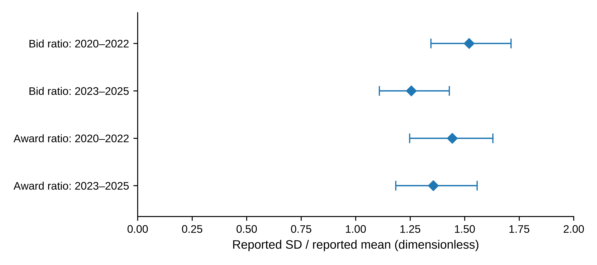
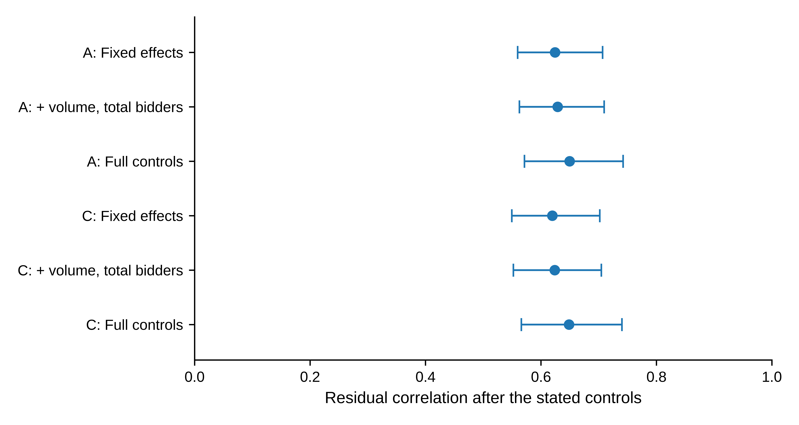

# Quantity dispersion and reported price deviations in European carbon auctions

Conditional associations and historical scope

**Zhongfei Tian · Xiang Wang**

Zhengzhou University of Aeronautics, Zhengzhou, Henan, China

**Corresponding author:** Zhongfei Tian · 15517837680@163.com

## Abstract

Published carbon-auction statistics summarize quantities, participation and prices, but their joint information is not captured by marginal summaries alone. We examine reported bid and award dispersion in 1,281 successful European Union Allowance auctions during 2020--2025, and extend the analysis to official price comparisons for 240 German auctions. Conditional residual correlations between the two quantity ratios are about 0.65 under two transformations. Their association is stronger in 2023--2025 despite lower marginal medians; selected-moment standardization retains positive period contrasts without balancing the full auction-volume distribution. In the German subsample, bid dispersion is negatively associated with the official-reported signed percentage deviation after controlling for auction scale, participation, demand coverage, bid-price range, the same-auction clearing price and year effects. An observed interquartile range of transformed dispersion corresponds to a fitted difference of −14.51 basis points, with an exploratory quarter-clustered 95% interval of \[−23.00, −6.01\]. The direction persists in two predefined source subsets, but the absolute-deviation interval includes zero and omitting 2022 materially attenuates the coefficient. A separate 2026 quantity sample retains positive association but has a short time axis. The findings distinguish quantity co-variation from the location and magnitude of reported price deviations. They provide conditional empirical information, not evidence of causal allocation effects, improved pricing efficiency or forecast performance; inference remains exploratory and the official signed convention is retained.

Keywords: European Union Allowances; primary auctions; quantity dispersion; reported price deviations; measurement; temporal heterogeneity

**JEL classification:** D44; C13; Q58

## 1 Introduction

Carbon-auction reports describe how much is bid, how many participants bid, and how quantities and prices differ across completed auctions. Official publications present quantity moments alongside volume and bidder counts, while market surveillance also considers participation and concentration (European Commission 2024; ESMA 2025). These summaries address distinct questions. Participation and aggregate demand do not fully describe the distribution of submitted quantities, and the dispersion of those quantities need not duplicate the information in the range of submitted prices. We study whether the reported quantity moments are associated with award dispersion and, in a matched German subsample, with official-reported price deviations.

Awards originate in bids, so a positive relationship between their dispersion is plausible. Its conditional magnitude and historical scope nevertheless require measurement rather than assumption. Our first question is how strongly the two reported quantity ratios co-vary after accounting for scale and participation, including whether that association differs between 2020--2022 and 2023--2025. The second question is whether bid dispersion has a price-related association beyond conventional auction characteristics. Both questions concern completed auction reports, not matched bidders or decisions observed before bidding.

The quantity analysis uses 1,281 successful auctions in the EU, DE and PL reporting series of the European Energy Exchange (EEX). It compares common-sample transformations, separate historical projections, a selected-moment composition adjustment and an additional 2026 time segment. The price extension uses 240 successful German auctions in 21 quarters, matched to official-reported secondary-market comparisons. It adds the bid-dispersion ratio to a fixed baseline containing scale, participation, demand coverage, submitted-price range, the same-auction clearing price, year effects and reference type. The two samples answer complementary questions; the price comparisons do not cover all 1,281 auctions.

Three findings organize the analysis. First, the quantity ratios have residual correlations near 0.65, with stronger association in the later historical period despite lower marginal ratio levels. Second, the German price comparison yields a negative conditional association: an observed interquartile range of transformed bid dispersion corresponds to a fitted signed-deviation difference of −14.51 basis points. Third, this is not evidence of convergence toward the reference price. The absolute-deviation interval includes zero, and the signed coefficient is sensitive in magnitude to observations from 2022. Composition and new-time checks further delimit, rather than universalize, the quantity finding.

Our contribution is to connect two forms of report-level information without treating them as interchangeable. Relative to the quantity summaries in official reports, we quantify conditional co-variation and its historical heterogeneity. Relative to price-focused auction analysis such as Bosco (2023), we examine the incremental association of a quantity-dispersion measure with reported price deviations, conditioning on conventional demand, participation and submitted-price variables. The distinction between signed and absolute deviations is substantive: the evidence concerns where the reported comparison lies, not a demonstrated reduction in its distance from zero. These descriptive relationships neither identify a bid-to-award-to-price mechanism nor validate an executable pricing signal.

The study is retrospective. Historical data and earlier findings were inspected before supplementary checks, and the price protocol was finalized after data inspection but before its first fit. We therefore retain the exploratory status of all uncertainty statements. Section 2 positions the questions in the auction and measurement literature. Section 3 defines the separate quantity and price estimands; Section 4 presents the findings and their limiting diagnostics. Sections 5 and 6 discuss the resulting information and scope. Online Resource 1 documents the source restrictions, complete supplementary results and study sequence.

## 2 Auction context and related research

### 2.1 Allocation, participation and quantities

EEX describes its emissions auctions as single-round, sealed-bid, uniform-price auctions. Bids are ranked by price, successful orders pay the clearing price, and marginal execution can be partial. Participants may bid on their own account or on behalf of clients (EEX n.d.). A reporting participant therefore need not be the final installation using allowances for compliance. This distinction matters for the quantities and counts studied here, which cannot be converted into client-level demand without additional information.

Allowance auction design matters for rents and allocation as well as the clearing price (Cramton and Kerr 2002). Multi-unit auction theory links bidding incentives and demand reduction to allocation outcomes (Ausubel et al. 2014). These considerations motivate attention to quantity distributions. Our data contain public aggregate moments rather than valuations or participant-specific bid schedules, so they support a description of quantity co-variation, not a test of strategic demand reduction.

The available observations distinguish auction-level totals, reported distributional summaries and bidder-level mechanisms. The first two are observed; the third is not recovered by aggregate regressions.

### 2.2 Direct comparisons and measurement interpretation

Bosco (2023), first published online in 2022, studies EUA auction prices and returns with GARCH specifications. Participation, demand coverage and the maximum-minus-minimum submitted bid price enter its analysis. That price range is distinct from quantity dispersion and is therefore included in our fixed price baseline. Our extension concerns a reported auction-to-secondary-market comparison, not price volatility or a new test of whether auction characteristics matter in general. Niu and Liu (2024) instead forecast EUA futures volatility; no forecasting contest is conducted here.

Otsubo (2026) studies intraday futures--ETF price discovery and a daily auction--futures--ETF comparison aligned to 16:00 UK time. We use the price deviations already reported by the German Emissions Trading Authority (DEHSt 2020--2025), rather than reconstructing synchronous native quotes or estimating cross-venue information shares. The source and timing distinctions prevent either analysis from being treated as a direct replication of the other.

Official reporting provides the measurement context. The Commission distinguishes individual-auction means from monthly aggregates and describes bid and award means using participating and successful bidders, respectively (European Commission 2024). ESMA (2025) separates participation from concentration indicators. The DEHSt quarterly reports provide the German price comparisons used in our extension. These dimensions are established reporting objects. The contribution is their conditional empirical relationship, not the introduction of the fields or a claim that official reporting has used them incorrectly.

Two measurement cautions shape the design. Shared ratio components can affect regression relationships, so normalizing by a mean is not a substitute for making totals and counts explicit (Kronmal 1993). In addition, association between observed indicators does not identify a latent common factor. The multiple-proxy framework of Meijer et al. (2025) makes the identification and normalization conditions for that different task explicit. We impose no such factor model. The analysis retains the original report fields, examines the specified transformations and control sets, and uses a separate algebraic check to explain the role of constructed denominators.

## 3 Data and empirical design

### 3.1 Reporting archive and sample definition

The data are six EEX annual primary-auction workbooks for 2020--2025, preserved in a fixed research snapshot. Extracting every dated row yields 1,327 records. The sample retains product code T3PA, the EU/DE/PL reporting series and an explicit successful status. The rule excludes 38 other-product records, five records outside the specified series and three cancelled auctions. It leaves 1,281 unique auctions between 7 January 2020 and 15 December 2025, covering all 72 calendar months. Table 1 gives their distribution. The three series belong to the same allowance market and are not independent-market replications.

**Table 1 Sample composition by year and reporting series**

  -----------------------------------------------------------------------
  **Year**            **EU**       **DE**       **PL**       **Total**
  ------------------- ------------ ------------ ------------ ------------
  2020                139          46           24           209

  2021                132          45           46           223

  2022                142          46           23           211

  2023                143          47           24           214

  2024                142          46           24           212

  2025                142          45           25           212

  Total               840          275          166          1281
  -----------------------------------------------------------------------

*Note:* Counts refer to successful T3PA auctions satisfying the stated series restriction. Cancelled auctions and other products are not recoded as zero outcomes. The first three years contain 643 auctions and the final three contain 638.

The selected sample has complete numeric fields for the fixed measures and controls. Both reported means are positive; neither standard-deviation field contains a zero. No auction is removed because its dispersion ratio is large or small. There is one selected auction per distinct date, but observations can remain dependent over time. Selection on successful completion defines the population of interest; the analysis does not describe cancelled auctions or latent demand.

Each record retains its source workbook, sheet and row. The completed source audit reconciled the exclusions and compared the numeric extraction with a separate XML-reading route. The audit establishes traceability of the supplied snapshot, not the first historical release of every field. Online Resource 1, Section S2, records the cell counts and verification scope.

For descriptive context, Table 2 reports the two dispersion ratios (reported standard deviation divided by reported mean), the conditioning variables and total bid volume. All summaries give each auction equal weight. Volumes are displayed in millions of tCO2; ratios and counts retain their original scales. Quartiles use linear interpolation. No winsorization, trimming or additional sample restriction is applied.

**Table 2 Descriptive statistics of the successful-auction sample**

  ----------------------------------------------------------------------------------------
  **Variable**             **Mean**   **Q1**   **Median**   **Q3**   **Min.**   **Max.**
  ------------------------ ---------- -------- ------------ -------- ---------- ----------
  Bid ratio $r^{b}$        1.404      1.202    1.387        1.579    0.847      2.622

  Award ratio $r^{w}$      1.422      1.215    1.399        1.598    0.443      2.707

  Cover ratio $R$          1.825      1.540    1.740        2.030    1.010      3.780

  Auction volume $V$       2.675      2.296    2.651        3.245    0.970      6.399

  Submitted volume $B$     4.717      3.986    4.736        5.321    1.937      12.899

  Total bidders $N$        22.663     20       23           25       12         31

  Successful bidders $S$   16.878     14       17           20       3          27
  ----------------------------------------------------------------------------------------

*Note:* All rows use 1,281 auctions. $V$ and $B$ are in million tCO2, $N$ and $S$ are bidder counts, and the three ratios are dimensionless. $B$ maps to the source field "Total Amount of Bids" in the workbook's volume section, not to auction revenue. Q1 and Q3 are the 25th and 75th percentiles. These are marginal descriptive statistics, not conditional estimates or bidder-level distributional comparisons.

The separate sample medians are 23 participating bidders, 17 successful bidders, 2.651 million tCO2 of auction volume and a cover ratio of 1.740; these need not occur in one observed auction. Median bid and award ratios are 1.387 and 1.399. Figure 1 shows the period-specific medians and interquartile ranges, with full summaries in Online Resource 1, Table S5. These marginal quantities are distinct from the conditional correlations below.

**Fig. 1** Marginal reported dispersion ratios by historical period; diamonds denote auction-level medians and horizontal segments extend from the 25th to the 75th percentile. Each early-period row contains 643 auctions and each late-period row 638. These segments describe the middle half of the observations; they are not confidence intervals or paired-bidder comparisons. The figure reuses the descriptive statistics in Online Resource 1, Table S5

### 3.2 Reported measures and linear projection

Let $\mu_{t}^{b},s_{t}^{b}$ denote the reported mean and standard deviation of bid volume, and $\mu_{t}^{w},s_{t}^{w}$ the corresponding reported moments of volume won. Define

$r_{t}^{b} = \frac{s_{t}^{b}}{\mu_{t}^{b}},\quad\quad r_{t}^{w} = \frac{s_{t}^{w}}{\mu_{t}^{w}}.$ (1)

We call these *reported dispersion ratios*. The original labels refer to volume per bidder. Nevertheless, the population underlying each standard deviation and its variance divisor have not been conclusively matched to the paired mean throughout the archive. The ratios are therefore not interpreted as verified coefficients of variation for an identical population before and after allocation. This restriction affects the economic interpretation, not the arithmetic definition in (1).

Specification A sets $x_{t} = \log\left( 1 + r_{t}^{b} \right)$ and $y_{t} = \log\left( 1 + r_{t}^{w} \right)$. The main conditional projection is

$y_{t} = \beta x_{t} + \mathbf{\gamma}^{\prime}\mathbf{z}_{t} + \alpha_{j(t)} + \delta_{m(t)} + u_{t},$ (2)

where $j(t)$ denotes the reporting series, $m(t)$ the original year--month, and $\mathbf{z}_{t} = \left( \log R_{t},\log V_{t},\log N_{t},\log S_{t} \right)^{\prime}$. Here $R$ is the reported cover ratio, $V$ reported auction volume, $N$ total bidders and $S$ successful bidders. The submitted-volume field $B$, used in the denominator audit and Table 2, is labelled "Total Amount of Bids" in the source workbook; it is not an additional regressor in (2). All observations have equal weight. The pooled full design has rank 79 and 1,202 residual degrees of freedom.

The fixed supplementary measurement comparison contains A, a positive-standard-deviation version of A labelled B, and a natural-log version C on the same positive sample. Since all selected standard deviations are positive, A and B are identical. B is retained in the reproduction record as a sample-eligibility check rather than a separate result. C uses $x_{t} = \log r_{t}^{b}$ and $y_{t} = \log r_{t}^{w}$ on exactly the same 1,281 rows. No constant is added to a zero standard deviation.

All variables concern the same completed auction. In particular, the cover ratio and successful-bidder count are simultaneous outcomes, not instruments or inputs known before bidding. Equation (2) is an equal-auction-weighted descriptive linear projection for the selected archive. Its coefficient depends on the conditioning set and on the distribution of those auctions. To examine dependence on those conditions, we also report fixed effects alone and fixed effects plus $\log V$ and $\log N$. These models answer related, but not identical, conditional questions. Year--month effects account for monthly levels; they do not absorb every daily common shock.

Reported means are numerically consistent with total submitted volume divided by $N$ and reported auction volume divided by $S$, to the archive's displayed precision. This creates an explicit denominator structure. Under natural logs, constructed means and a constructed cover ratio yield additive identities that disappear after projection on the corresponding totals and counts. The log-one-plus transformation does not have that property. Online Resource 1 derives and checks these identities, keeping constructed fields separate from the reported fields used in (2).

### 3.3 Magnitude, dependence and sensitivity

Let $\mathbf{Z}$ contain the nuisance regressors and fixed effects in (2), and let $M_{Z}$ denote the residual-maker for that space. With $\widetilde{\mathbf{x}} = M_{Z}\mathbf{x}$ and $\widetilde{\mathbf{y}} = M_{Z}\mathbf{y}$, the coefficient and standardized association are

$\widehat{\beta} = \frac{{\widetilde{\mathbf{x}}}^{\prime}\widetilde{\mathbf{y}}}{{\widetilde{\mathbf{x}}}^{\prime}\widetilde{\mathbf{x}}},\quad\quad\widehat{\theta} = \widehat{\beta}\frac{s\left( \widetilde{\mathbf{x}} \right)}{s\left( \widetilde{\mathbf{y}} \right)}.$ (3)

This is the partial-regression representation (Lovell 1963). In the present equal-weight, single-added-regressor setting, $\widehat{\theta}$ is the sample correlation of the two residuals. The partial coefficient of determination satisfies

$R_{\text{partial}}^{2} = \frac{{SSE}_{Z} - {SSE}_{Z,x}}{{SSE}_{Z}} = {\widehat{\theta}}^{\, 2}.$ (4)

These are complementary scales for the same association, not independent pieces of evidence. The residual correlation is symmetric in the two indicators; placing award dispersion on the left of the regression does not establish a direction of transmission. Pooled and subperiod correlations use their respective fitted control spaces and variances, so a change in correlation need not be a change in a structural parameter. We also report the fitted transformed-response contrast corresponding to an observed interquartile range of residualized $x$. It is a scale illustration along the fitted partial regression, not an intervention or an expected procurement gain.

The principal uncertainty calculation uses a month-block resampling design for dependent observations, within the general class discussed by Lahiri (2003). It resamples non-circular blocks of three consecutive calendar months. Starting months are drawn with replacement; blocks are concatenated and truncated to a 72-month axis. All auctions in a selected month are retained jointly. Repeated months increase row multiplicities and retain their original fixed-effect labels. The entire conditional projection is re-estimated for each of 999 draws. A and C share the draw indices. One- and six-month blocks, with 199 draws each, provide bounded sensitivity checks. Intervals are percentile intervals with linear quantile interpolation.

We examine influence by deleting each observation, month, year and series, and by jointly omitting the 13 largest-Cook-distance observations under each specification (Cook 1977). These diagnostics do not redefine the main sample. Within-series models retain their own monthly effects; empty months retain their positions on the 72-month resampling axis. Reduced-control and within-series intervals use 499 and 399 three-month block draws, respectively.

### 3.4 Historical comparison and research process

The historical comparison divides 2020--2022 from 2023--2025, a split already present in earlier exploration. The two samples contain 643 and 638 observations, and all nuisance coefficients are estimated separately. Each 36-month half is independently resampled in three-month blocks for 999 paired draws, with common indices across transformations. The protocol's primary contrasts are late-minus-early slopes, *Δβ = β*~late~* − β*~early~. Each transformation receives a 97.5% percentile interval as a Bonferroni-style nominal family-95% sensitivity calculation, conditional on adequate individual interval approximations. We also display the previously computed secondary contrasts *Δθ = θ*~late~* − θ*~early~ with their exploratory 95% intervals. These are direct comparisons of standardized association; a slope-difference interval does not test a correlation difference. The secondary intervals are neither family-adjusted over the two transformations nor replacements for the originally designated primary contrasts.

The historical archive and earlier results were inspected before supplementary protocols were recorded; evidence for the first protocol freeze is partial. No untouched holdout or preregistration is claimed. Month-block intervals approximate temporal dependence, but do not adjust for the full specification search, arbitrary changes in the relationship, or all dependence across the period boundary. Separate multiplicity sensitivities do not establish familywise coverage across every analysis in this article. Online Resource 1, Section S13, maps each estimand to its evidence status.

Generative AI tools, including ChatGPT, assisted research organization, code-related work, and manuscript drafting and revision. Their use included generative drafting, not only copy editing. The authors remain responsible for the analysis, citations and final manuscript. Each completed numerical stage and its checks are versioned separately. This manuscript integrates those stages without treating later specification decisions as prospective registration.

### 3.5 Composition sensitivity of the historical comparison

We use descriptive overlap weights to emphasize auction characteristics represented in both historical periods. Following Li et al. (2018), one unpenalized logistic model predicts late-period membership from an intercept, the four pooled-standardized log controls, their squared terms, reporting-series indicators and month-of-year indicators. Neither dispersion measure, price, year nor specific year--month enters this model. Early weights are the fitted late-period probabilities; late weights are one minus those probabilities. Coverage and successful participation remain joint auction outcomes. The weights standardize selected observed moments and are not a causal treatment design.

Within each period, both transformed indicators are projected on the original controls and year--month effects by weighted least squares. We compute their weighted residual covariance and divide by the product of the weighted residual standard deviations, using the same weights throughout. The supplemental contrast is the late-minus-early difference in that correlation. Every block draw refits the period-membership model and both outcome projections. The main calculation uses 999 three-month draws, with 199 draws each for one- and six-month sensitivity checks. Individual 97.5% percentile intervals address the two weighted contrasts only as a limited multiplicity sensitivity. Weight concentration, fitted-term balance, distribution distances and the paired change from equal weighting are reported together. No outcome-dependent trimming or alternative weight-model search is used.

### 3.6 New-time sample and finite short-axis diagnostics

The additional sample uses the same product, success-status and series rules, with January--September 2026 fixed before its estimation. The annual file contains 173 dated rows; seven October rows are excluded, leaving 166 auctions: 111 EU, 35 DE and 20 PL. All nine months are represented, and required labels match the historical schema. Both specifications are re-estimated using 2026 year--month effects. The exercise therefore checks a relationship in a new time period of the same market, not predictions from a frozen historical model.

A nine-month axis provides only seven non-circular three-month source blocks. Following the initial 999 draws, a post-result diagnostic enumerates the finite non-circular and circular resampling distributions and deletes each month in turn. Non-circular sampling underweights endpoint months; circular sampling balances their expected inclusion but joins September to January artificially. The resulting ranges are short-axis diagnostics, not certified coverage intervals. Original results remain available in Online Resource 1, Section S11, and no formal difference between 2026 and earlier years is tested.

### 3.7 Reported price deviations in the matched German sample

The price extension pairs the EEX quantity fields with comparisons printed in DEHSt quarterly reports for 2020--2025. Source reconciliation identifies 275 German successful auctions across all 24 quarters. The prefit source restrictions quarantine 35 observations for reference-footnote or date inconsistencies, leaving 240 auctions in 21 quarters. Of these, 236 use a last-best-bid reference and four a last-trade reference. The predefined no-row-flag subset contains 203 auctions in 18 quarters. These are subsets of the historical archive, not additional auctions or an independent market.

Let d denote the official signed numeric percentage deviation multiplied by 100, so that its unit is a basis point. A printed −0.07% becomes −7 basis points. The study does not infer an unreported denominator or recover a native reference price from rounded entries. Reported zeros remain zeros at publication precision, not missing values, no-trade indicators or proof of exact unrounded equality. The focal regressor x is the same log-one-plus bid-dispersion ratio used in specification A. We fit the descriptive projection

$d_{t}\  = \ a\  + \ \kappa\ x_{t}\  + \ \mathbf{\lambda}^{\prime}\mathbf{c}_{t}\  + \ \eta_{Y}\  + \ e_{t}$ (5)

where Y denotes the calendar year of auction t and c contains log auction volume, log total and successful bidder counts, log reported coverage, the highest-minus-lowest submitted price in euros, log same-auction clearing price, and a last-trade indicator when it varies. The year effects differ from the year--month effects in the quantity analysis. The full primary design has rank 14 and 226 residual degrees of freedom. Its baseline omits only x on exactly the same rows. No reported award-dispersion term is used to infer a mediation channel. All controls describe completed auctions; in particular, clearing price and coverage are simultaneous outcomes.

Uncertainty is reported using quarter-clustered CR1 covariance and t(G−1) 95% intervals, with G equal to the number of observed quarters. The primary coefficient also receives one null-imposed wild-cluster t test with 999 Rademacher draws. A mean-centred delete-quarter jackknife (CV3J) and six fixed leave-one-year-out estimates assess influence. These procedures are related checks on the same data, not independent confirmations; cross-quarter independence and small-cluster calibration remain assumptions (MacKinnon et al. 2023). The CR1 interval is not a bootstrap interval.

The locked secondary specifications use the absolute deviation on the same 240 rows, the signed deviation on the 203 no-row-flag observations, and the signed deviation on the 236 best-bid observations. The main scale illustration is κ times the observed interquartile range of x, holding the fitted conditioning set fixed. A contrast using the interquartile range of residualized x is retained separately. Neither is a feasible intervention or monetary return. The final code and specifications were fixed before the first price fit but after inspection of the source data. Twenty-two separately acquired German price observations from 2026 were not fitted or merged into this analysis.

## 4 Results

### 4.1 Magnitude of the pooled relationship

The two transformations give nearly identical standardized associations (Table 3). Residual correlations are 0.6496 under A and 0.6486 under C, with three-month block intervals \[0.5714, 0.7422\] and \[0.5660, 0.7402\]. Corresponding slopes are 0.8802 and 0.8797. The comparison uses exactly the same auctions; no zero-standard-deviation observations distinguish the samples.

**Table 3 Pooled conditional association**

  ----------------------------------------------------------------------------------------------------------------------------
  **Transformation**   $\widehat{\beta}$   **95% interval for** $\beta$   $\widehat{\theta}$   **95% interval for** $\theta$
  -------------------- ------------------- ------------------------------ -------------------- -------------------------------
  A: log-one-plus      0.8802              \[0.7506, 1.0384\]             0.6496               \[0.5714, 0.7422\]

  C: natural log       0.8797              \[0.7627, 1.0143\]             0.6486               \[0.5660, 0.7402\]
  ----------------------------------------------------------------------------------------------------------------------------

*Note:* Each row uses 1,281 successful auctions, the full controls and reporting-series and year--month effects. Intervals use 999 three-month block draws. The planned positive-sample log-one-plus specification B equals A and is not duplicated. The intervals are exploratory, as described in Section 3.4.

The partial $R^{2}$ is approximately 0.422 under A and 0.421 under C. These values describe the in-sample reduction in residual squared error relative to the fitted control-only model, not validation of one indicator as a substitute for the other. They do not describe a proportion of total market variation explained or an out-of-sample improvement. To illustrate the association on its transformed scale, the frozen estimates imply fitted contrasts of 0.0816 under A and 0.1408 under C across their respective observed interquartile ranges of residualized bid dispersion. Different transformations have different units, so equality of those contrasts is neither expected nor required.

The pooled correlation intervals remain positive in the one- and six-month block checks (Online Resource 1, Table S2). Both principal slope intervals in Table 3 include one. A slope across reports is not a within-auction comparison of an identical bidder population, however, so its value relative to one does not test dispersion compression.

### 4.2 Controls, influence and reporting series

The positive direction is not confined to the full conditioning set (Fig. 2). With series and year--month effects only, residual correlations are 0.6243 and 0.6197. Adding volume and total bidders gives 0.6289 and 0.6239. The relationship is therefore present without the cover ratio and successful-bidder count as controls. These are different descriptive projections, not an exogeneity or collider-bias test.

**Fig. 2** Residual correlations across conditioning sets; A and C denote log-one-plus and natural-log ratios, respectively. Bars are exploratory 95% three-month block intervals, using 499 draws for the reduced controls and 999 for full controls. FE denotes reporting-series and year--month effects; full controls also include the cover ratio and successful-bidder count. Exact values are retained in Online Resource 1, Table S6. These rows are related descriptive projections, not independent replications

The completed deletion checks retain a positive association (Online Resource 1, Table S3). They remove observations, months, years or reporting series without replacing the principal sample. Omitting the 13 largest-Cook-distance observations gives correlations of 0.6911 and 0.6930; this is an influence diagnostic, not a revised data-cleaning rule. No observation is classified as erroneous solely because it is influential.

Within-series correlations are positive under both transformations (Online Resource 1, Table S4). EU, DE and PL are reporting series within one market, not independent replications. The PL comparison has 166 observations and only 90 residual degrees of freedom. These diagnostics address specified sources of sensitivity; they do not exclude shared determinants of bidding and awards.

### 4.3 Directional persistence and temporal heterogeneity

Conditional association is higher in the later historical sample (Table 4). Panel A reports correlations of 0.5501 and 0.7798 under A, and 0.5414 and 0.7719 under C, in 2020--2022 and 2023--2025 respectively. Panel B retains the originally designated slope contrasts; Panel C and Fig. 3 report the direct, secondary correlation contrasts. The two contrast scales are not interchangeable.

**Table 4 Historical period comparison**

*Panel A: Period-specific estimates*

  ---------------------------------------------------------------------------------------------
  **Spec.**   **Period**   $n$    $\widehat{\beta}$   $\widehat{\theta}$ **\[95% interval\]**
  ----------- ------------ ------ ------------------- -----------------------------------------
  A           2020--2022   643    0.6728              0.5501 \[0.4570, 0.6486\]

  A           2023--2025   638    1.1825              0.7798 \[0.6757, 0.8892\]

  C           2020--2022   643    0.6880              0.5414 \[0.4394, 0.6493\]

  C           2023--2025   638    1.1232              0.7719 \[0.6645, 0.8829\]
  ---------------------------------------------------------------------------------------------

*Panel B: Late-minus-early slope differences*

  ----------------------------------------------------------------------------------
  **Transformation**   $\Delta\widehat{\beta}$   **97.5% interval**
  -------------------- ------------------------- -----------------------------------
  A                    0.5097                    \[0.3340, 0.7222\]

  C                    0.4353                    \[0.2605, 0.6344\]
  ----------------------------------------------------------------------------------

*Panel C: Late-minus-early residual-correlation differences (secondary exploratory contrasts)*

  -----------------------------------------------------------------------------------
  **Transformation**   $\Delta\widehat{\theta}$   **Exploratory 95% interval**
  -------------------- -------------------------- -----------------------------------
  A                    0.2297                     \[0.0875, 0.3681\]

  C                    0.2305                     \[0.0808, 0.3748\]
  -----------------------------------------------------------------------------------

*Note:* All nuisance coefficients are estimated separately in the two halves. The frozen 999 paired draws resample three-month blocks independently within each 36-month half, using common indices across transformations. Panel A gives 95% intervals for each period's correlation. Panel B retains the primary slope contrasts and their 97.5% intervals. Panel C displays the already computed secondary correlation contrasts with 95% intervals, without multiplicity adjustment across transformations. This presentation does not promote Panel C to a prospectively primary analysis. Historical selection and cross-boundary dependence limitations apply to all panels.

The direct correlation differences are 0.2297 under A and 0.2305 under C, with secondary 95% intervals of \[0.0875, 0.3681\] and \[0.0808, 0.3748\]. The primary slope differences are 0.5097 and 0.4353, with the distinct 97.5% intervals shown in Panel B. Thus, both scales describe a stronger fitted relationship in the later sample under the stated exploratory scheme. The evidence for the correlation contrast is its own interval, not significance of $\Delta\beta$ or non-overlap of period-specific bars.

**Fig. 3** Late-minus-early differences in residual correlation, comparing 2023--2025 with 2020--2022; squares mark the two transformations identified by their row labels. Bars reproduce the frozen secondary exploratory 95% intervals, without adjustment across transformations. The vertical line marks zero difference. Primary slope contrasts and their 97.5% intervals are reported separately in Table 4, Panel B

The marginal levels move differently: the median bid ratio is 1.520 in 2020--2022 and 1.255 in 2023--2025, while award medians are 1.443 and 1.356 (Online Resource 1, Table S5). Lower report-ratio levels thus coexist with stronger conditional association. This is a comparison of auctions, not matched bidders, and does not establish improved equality. The January 2023 boundary is a historical split, not an identified policy intervention.

### 4.4 Composition weighting: persistence with incomplete distributional balance

The overlap-weighted differences remain positive: 0.1971 under A and 0.1937 under C (Table 5). Their exploratory 97.5% intervals are \[0.0947, 0.3029\] and \[0.0847, 0.3051\]. The paired changes from equal weighting are −0.0326 and −0.0368, with 95% intervals \[−0.1349, 0.0802\] and \[−0.1449, 0.0797\]. Because these paired intervals include zero, the analysis does not establish that weighting reduced the contrast, or quantify a fraction attributable to composition.

**Table 5 Composition-weighted association and distributional diagnostics**

Panel A: Weighted residual correlations and late-minus-early differences

  ---------------------------------------------------------------------------------------
  **Spec.**   **Early θ**   **Late θ**   **Difference**   **97.5% interval**
  ----------- ------------- ------------ ---------------- -------------------------------
  A           0.5703        0.7675       0.1971           \[0.0947, 0.3029\]

  C           0.5649        0.7586       0.1937           \[0.0847, 0.3051\]
  ---------------------------------------------------------------------------------------

Panel B: Empirical distribution distances before and after weighting

  -----------------------------------------------------------------------------------
  **Log variable**              **Original KS distance**   **Weighted KS distance**
  ----------------------------- -------------------------- --------------------------
  Auction volume                0.2810                     0.2908

  Total bidders                 0.1080                     0.0364

  Successful bidders            0.0454                     0.0201

  Cover ratio                   0.1142                     0.0579
  -----------------------------------------------------------------------------------

Note: Each weighted comparison retains 643 early and 638 late auctions. The period-membership and outcome models are refitted in 999 three-month block draws. Included-term mean differences are below 1.6×10⁻¹⁵; weight-concentration effective sample sizes are 586.55 and 614.75, not independent temporal sample sizes. KS is the maximum empirical cumulative-distribution distance, not a p-value. Tables S7--S8 provide paired changes and block sensitivities.

Matching the selected moments does not match the full distributions. Log auction-volume KS distance increases from 0.2810 to 0.2908 even though its first and second moments balance; the other three distances decrease. The evidence supports a positive period contrast under this particular moment standardization, not invariance to all composition differences. The volume diagnostic was not used to select a different weight model or sample.

### 4.5 New-time evidence and sensitivity to the nine-month axis

The January--September 2026 sample also shows positive association. Residual correlations are 0.8494 and 0.8350, with slopes 1.3137 and 1.2375. All leave-one-month-out correlations remain positive: 0.8396--0.8626 for A and 0.8230--0.8569 for C. These are same-market, new-period estimates from 166 auctions, not predictive accuracy or a formal test of further strengthening after 2025.

The original block intervals and complete enumeration results are retained in Online Resource 1, Table S9. Non-circular and circular sampling produce different diagnostic percentile ranges; neither expands the nine-month historical record. Accordingly, the additional sample supports the recurrence of the positive direction, with limited evidence about temporal uncertainty. It is not used as a confirmatory replication or as a substitute for the historical sample.

### 4.6 Quantity dispersion and official-reported price deviations

The signed deviation in the 240-auction price sample has a mean of −2.80 and median of −7.00 basis points, with quartiles −29.00 and 17.25 and sample standard deviation 46.34. There are 142 negative observations (59.17%), 92 positive observations (38.33%) and six reported zeros (2.50%). The absolute deviation has mean 33.51 and median 25.00 basis points. Panel A of Table 6 provides the primary descriptive context; Online Resource 1, Table S11, also reports the two source subsets. These unconditional distributions are not the conditional contrast estimated below.

**Table 6 German reported-price context and conditional associations**

Panel A: Primary-sample descriptive context (240 auctions, 21 quarters; basis points)

  -------------------------------------------------------------------------------------------------
  **Outcome**          **Mean**   **Median**   **Q1--Q3**          **Range**             **SD**
  -------------------- ---------- ------------ ------------------- --------------------- ----------
  Signed deviation     −2.80      −7.00        \[−29.00, 17.25\]   \[−174.00, 171.00\]   46.34

  Absolute deviation   33.51      25.00        \[11.00, 46.00\]    \[0.00, 174.00\]      32.06
  -------------------------------------------------------------------------------------------------

Panel B: Fixed price specifications

  -------------------------------------------------------------------------------------------------------
  **Specification**   **n / G**   **κ \[95% CI\]**      **IQR(x)**   **IQR contrast\     **Partial R²**
                                                                     \[95% CI\], bp**    
  ------------------- ----------- --------------------- ------------ ------------------- ----------------
  Primary: signed     240/21      −78.72\               0.1843       −14.51\             0.0681
                                  \[−124.80, −32.64\]                \[−23.00, −6.01\]   

  S1: absolute        240/21      41.35\                0.1843       7.62\               0.0189
                                  \[−13.58, 96.29\]                  \[−2.50, 17.74\]    

  S2: no row flags    203/18      −81.46\               0.1856       −15.12\             0.0744
                                  \[−138.39, −24.53\]                \[−25.68, −4.55\]   

  S3: best bid only   236/21      −83.62\               0.1828       −15.29\             0.0758
                                  \[−129.71, −37.54\]                \[−23.71, −6.86\]   
  -------------------------------------------------------------------------------------------------------

Note: Panel A gives unconditional summaries of the reported percentage scale, with sample SD using n−1 and linear-interpolation quartiles. The signed observations comprise 142 negative, 92 positive and six printed-zero values. Panel B retains one primary and three secondary models; each baseline and extension uses identical observations. κ is in basis points per unit of log(1 + bid ratio). Intervals use quarter-cluster CR1 covariance and t(G−1), not bootstrap quantiles. Each IQR contrast uses its own observed x range; partial R² is in-sample. The absolute outcome concerns magnitude, not the signed outcome tested in the primary model. Model and inference definitions are in Section 3.7.

Adding bid dispersion to the fixed baseline gives κ = −78.72 basis points per unit of x (Table 6, Panel B). The observed interquartile range of x is 0.1843, yielding a fitted signed-deviation difference of −14.51 basis points and a CR1-t interval of \[−23.00, −6.01\]. These values concern the signed report scale: they do not establish that prices are closer to an efficient benchmark. The incremental partial R-squared is 0.0681, an in-sample residual-variation statistic rather than predictive improvement.

The restricted wild-cluster test gives p = 0.005, and the mean-centred quarter-jackknife coefficient interval is \[−136.54, −20.90\]. Both are reported alongside, not as the source of, the CR1 interval. The negative signed association also appears in the 203-observation no-row-flag subset and the 236-observation best-bid subset. Their fitted interquartile contrasts are −15.12 and −15.29 basis points, with their own sample-specific x ranges. Subset agreement does not eliminate remaining measurement differences or make the observations independent.

The absolute-deviation specification gives an interquartile contrast of +7.62 basis points with interval \[−2.50, 17.74\]. Thus the analysis does not establish a reduction in absolute deviation, nor does the interval prove a zero relationship. All six leave-year-out point estimates of the signed coefficient are negative, ranging from −88.23 to −45.12. Omitting 2022 changes the coefficient from −78.72 to −45.12. This substantial attenuation makes a claim of stable cross-year magnitude inappropriate; no deletion-specific significance claim is made. Complete deletion results and the distinct observed-x and residualized-x scales are retained in Online Resource 1, Tables S12--S13.

## 5 Discussion

### 5.1 Quantity information beyond marginal summaries

Two economic descriptions of this reporting archive differ. The later historical auctions have lower marginal dispersion ratios but a stronger conditional relationship between the bid-side and award-side measures. Reading only levels would miss the change in co-variation; reading only the pooled regression would hide its historical heterogeneity. Reporting both describes the observed quantities more fully without ranking either period by allocation quality.

The period comparison addresses observed composition only to a specified extent. Positive weighted contrasts remain after selected log-scale means and second moments are balanced, while the auction-volume distribution retains a shape difference. The 2026 exercise addresses a different question: whether the positive direction appears in an additional time segment. It does, but the short segment cannot establish a stable long-run mapping. These exercises narrow the scope of the historical relationship rather than identify why it changed.

The matched German analysis extends this characterization to a different outcome. Bid dispersion is associated with the official signed price comparison beyond the specified baseline, which includes both demand coverage and submitted-price range. This provides price-related conditional information not established by the bid--award correlation alone. It does not show that award dispersion mediates the price relationship: the extension tests neither a mediation model nor a causal transmission channel.

### 5.2 Signed price association is not price alignment

The price extension changes what can be said about the quantity indicator. It is not associated only with another quantity summary: within the selected German reports, it also carries incremental conditional information about the signed price comparison beyond demand coverage, participation and submitted-price range. The finding remains specific to that baseline, sample and report convention. It does not mean that quantity dispersion is an exogenous driver of the clearing price.

The signed and absolute results answer different economic questions. A lower signed deviation need not reduce distance from the reference; whether it would do so depends on the starting position and the unobserved joint distribution. The sample contains both negative and positive deviations, and the absolute-outcome interval does not establish closer price alignment. Consequently, neither the −14.51-basis-point contrast nor its ratio to a descriptive mean should be interpreted as a procurement saving or an efficiency gain. The 2022 deletion similarly delimits the historical magnitude without identifying that year\'s contribution or an underlying policy mechanism.

### 5.3 Identification, inference and data limits

Measurement is the first limit. The standard-deviation populations and variance divisors are not fully documented across the archive, and reporting participants may represent clients. The ratios are arithmetically defined but are not authenticated matched-population inequality measures. Identical labels across files do not establish unchanged statistical populations.

Selection and simultaneity limit both analyses. We condition on successful auctions and, for prices, on source-based eligibility. Participation, coverage, awards and clearing prices can share determinants. The price-level control is explicitly the same-auction clearing price, a component of the underlying comparison rather than an external pre-auction covariate. Its inclusion defines a conditional projection, not a total effect. Neither reduced-control quantity models nor source-subset price models eliminate endogenous selection, common shocks or omitted demand conditions.

Inference remains conditional on the chosen dependence approximations and the research sequence. The quantity period contrasts and later composition contrasts are separate families; no correction covers the complete exploration history. In the price analysis, CR1 and jackknife intervals and the restricted wild-cluster test use the same observations, while the small number of quarters and possible cross-quarter dependence limit their calibration. Agreement across these procedures is not independent replication. Likewise, exact enumeration of the 2026 quantity resampling distribution removes Monte Carlo variation, not uncertainty about repeated-sample coverage.

The price outcome is measured at official publication precision. It uses 236 last-best-bid references and four last-trade references, neither of which is an independently reconstructed midpoint. A targeted check of the methods text in the 24 held reports did not establish an explicit subtraction-and-denominator equation. We therefore retain the reported sign and percentage scale and describe the association as a lower official-reported signed deviation, not a widening auction discount. Native quote age, an independently authenticated UTC event clock and cross-report measurement invariance remain unverified. These limitations narrow the interpretation of the completed price analysis; they do not mean it was unperformed.

## 6 Conclusion

Across 1,281 successful EUA auctions during 2020--2025, reported bid and award dispersion have a residual correlation near 0.65. Their association is stronger in the later historical period despite lower marginal ratio levels. The period contrast survives selected-moment standardization, although auction-volume distributions remain unequal. The separate 2026 quantity sample is directionally consistent but provides only short-axis temporal diagnostics.

In the matched 240-auction German subsample, reported bid dispersion is negatively associated with the official signed price deviation conditional on conventional auction indicators and the same-auction price level. The fitted interquartile contrast is −14.51 basis points. The absolute-deviation result and the influence of 2022 do not justify a blanket claim of greater price alignment or stable magnitude. Together, the findings identify distinct report-level quantity and price relationships, not a causal allocation mechanism, procurement saving or forecast improvement.

## Data and computer code availability

Data and computer code are documented at fixed revisions of repository 124-creator/-123. Historical quantity inputs are identified by 5745eb3ddca79602346053446583d794b0e09800; the completed price code, aggregate estimates and verification records are fixed at fccd471de96548bd781c59aced4a59435aae08ac. Post-estimation price descriptions and source-definition checks are fixed at 33707c164c80accd7acf9fcd3f0965088a8370f6. Online Resource 1 lists the earlier quantity analyses and the price-report locators. The authors hold the German official PDFs and matched event-level tables; those files are not included in the public aggregate package because bulk redistribution rights have not been established. Public outputs permit code and arithmetic review but not an independent row-level refit. The exact 2026 quantity snapshot is also absent from the package; its dynamic URL and hash do not substitute for accessible matching bytes. Provider rights and a lawful source-access arrangement must be respected in any journal deposit.

## Statements and Declarations

Funding: The authors received no financial support for this research.

**Competing interests:** \[Both authors must confirm their relevant financial and non-financial interests before submission.\]

**Author contributions:** \[Zhongfei Tian and Xiang Wang must confirm their actual contributions in the separate title-page record; author order is not a substitute for a contribution statement.\]

## Supplementary information

Online Resource 1 Field dictionary, source provenance, supplementary quantity and price estimates, uncertainty diagnostics and evidence-status map

## References

Ausubel LM, Cramton P, Pycia M, Rostek M, Weretka M (2014) Demand reduction and inefficiency in multi-unit auctions. The Review of Economic Studies 81:1366--1400. https://doi.org/10.1093/restud/rdu023

Bosco B (2023) Trade, equilibrium prices and rents in European auctions for emission allowances. Environmental Economics and Policy Studies 25:87--113. https://doi.org/10.1007/s10018-022-00344-y

Cook RD (1977) Detection of influential observation in linear regression. Technometrics 19:15--18. https://doi.org/10.1080/00401706.1977.10489493

Cramton P, Kerr S (2002) Tradeable carbon permit auctions: how and why to auction not grandfather. Energy Policy 30:333--345. https://doi.org/10.1016/S0301-4215(01)00100-8

EEX (n.d.) Frequently Asked Questions: Emissions Auctions. European Energy Exchange. https://www.eex.com/en/faq. Accessed 10 October 2026

European Commission (2024) Auctions by the Common Auction Platform: April, May, June 2024. https://climate.ec.europa.eu/document/download/d962459c-021e-4901-b49f-e5d37e5d2c93_en?filename=cap_report_202406_en.pdf. Access record: 10 October 2026

European Securities and Markets Authority (ESMA) (2025) Market Report on EU carbon markets. ESMA50-481369926-30552. https://www.esma.europa.eu/sites/default/files/2025-10/ESMA50-481369926-30552_Carbon_Markets_Report_2025.pdf. Accessed 10 October 2026

German Emissions Trading Authority (DEHSt) (2020--2025) Quarterly reports on German auctions of emission allowances. Umweltbundesamt, Berlin. Report-specific editions, Table 4 page locators and source URLs are recorded in Online Resource 1, Section S17, and the accompanying source ledger.

Kronmal RA (1993) Spurious correlation and the fallacy of the ratio standard revisited. Journal of the Royal Statistical Society: Series A 156:379--392. https://doi.org/10.2307/2983064

Lahiri SN (2003) Resampling methods for dependent data. Springer, New York. https://doi.org/10.1007/978-1-4757-3803-2

Li F, Morgan KL, Zaslavsky AM (2018) Balancing covariates via propensity score weighting. Journal of the American Statistical Association 113:390--400. https://doi.org/10.1080/01621459.2016.1260466

Lovell MC (1963) Seasonal adjustment of economic time series and multiple regression analysis. Journal of the American Statistical Association 58:993--1010. https://doi.org/10.1080/01621459.1963.10480682

MacKinnon JG, Nielsen MØ, Webb MD (2023) Fast and reliable jackknife and bootstrap methods for cluster-robust inference. Journal of Applied Econometrics 38:671--694. https://doi.org/10.1002/jae.2969

Meijer E, Postepska A, Wansbeek T (2025) Handling multiple proxies. Empirical Economics 69:2901--2926. https://doi.org/10.1007/s00181-025-02825-x

Niu H, Liu T (2024) Forecasting the volatility of European Union allowance futures with macroeconomic variables using the GJR-GARCH-MIDAS model. Empirical Economics 67:75--96. https://doi.org/10.1007/s00181-023-02551-2

Otsubo Y (2026) Intraday and daily price discovery in carbon markets: EUA futures versus carbon ETFs. International Review of Finance 26:e70099. https://doi.org/10.1111/irfi.70099
